# 001 - Language-Agnostic Quality Check

## User Story

As a maintainer of many repositories, I want one `quality` command that checks staged changes and whole repositories against one strict, language-agnostic rule set, so that security policies, coding standards and clean code practices have a single point of truth across package-manager, skills, Infinito.Nexus core and every other repository.

## Decisions (operator-confirmed 2026-11-06; do not re-litigate)

1. **Own repository**: `infinito-nexus/quality` is the single point of truth. The workspace holds 94 repositories, 32 of them Python projects, and only 10 configure ruff. Rejected: `pkgmgr check` (the 2026-11-05 pick), because a linter is not a package manager's job and every rule change would wait on pkgmgr's 15 workflows.
2. **Architecture**: known tools do the checking. Own code is limited to rule data, `.qualityignore.yml` and a thin runner with a differential gate. Rejected: `pre-commit` plus `reviewdog` (filtering on added lines misses findings caused by deletions, and `pre-commit` rewrites the work tree for partial staging, racing parallel agents); an own Rust engine (high effort, ruff and others stay subprocesses anyway); MegaLinter (no index mode, AGPL, 4.5 GiB compressed); Trunk (closed source, private repositories free only up to 5 committers); Qlty (BSL-1.1, no documented index flag); Semgrep alone (no index mode, restricted rule licence, 7 s on core).
3. **Runner language**: Python with the standard library, `PyYAML` and `pathspec`. Startup with imports measured 0.08 s against a tool median of 0.12 s per commit, and rules are data, so a later rewrite stays cheap. Rejected: Rust and Go (neither toolchain is on the host, and the gain is at most that 0.08 s per run).
4. **Modes**: `quality check --staged` judges the exact git index, `--base <ref>` compares the merge base with `HEAD` for CI, `--all` checks every tracked file absolutely.
5. **Differential gate**: the same quality version runs on both sides, with no baseline file. A finding is new only if the count of its path-free fingerprint (rule plus whitespace-free source line, as a multiset) rises and the per-file count (rule plus message with digits and paths normalised) rises. Renames are mapped from `git diff -M`. A vulnerable-package finding is judged by its vulnerability ids instead: it is new when the same lockfile held that package (named as its registry resolves it: PEP 503 for PyPI, lowercase for Composer, unchanged for npm and Go, where case tells packages apart) without one of those ids on the base side, so a swap or a downgrade is new and an upgrade that keeps a subset of the ids is not. A tool that fails on the base side leaves that side without its findings, so each of its head findings counts as new, and the report says so. Rejected: a shrink-only ledger (adjacent removals conflict on merge, identical lines collide, file-level findings have no line, any new rule must grow it); an added-lines filter (hides findings caused by deletions, such as `F401` after deleting a last use). Accepted limits: extracting a function or renaming a variable on a legacy line can report a false new finding.
6. **Metric rules**: file lines, folder items, complexity, function length and parameters compare numbers per entity. A legacy value over the limit passes while it does not grow. Growth, or a new entity over the limit, is a finding.
7. **Legacy code stays**: `--staged` and `--base` block only new findings. `--all` reports everything and exits 1 while findings remain, and CI does not gate on it until a repository is clean. Standards a project does not want are disabled in `.qualityignore.yml`. Rejected: `--all` as a CI gate from day one (ruff ALL reports 55880 findings on core; core's rule set reports 1050 on package-manager and 129 on skills).
8. **Hard rules**: rules marked `hard` skip the differential: absolute on touched files under `--staged`, on files changed in the range under `--base`, on every file under `--all`. Initial set: secret detection, `eval` or `exec` of non-literal input, disabled TLS verification, shell execution of non-literal input. Rejected: all of ruff `S` (`S603` and `S607` alone are 408 of 667 `S` findings on core, and 39 of 300 sampled commits would go red for code they did not write).
9. **`.qualityignore.yml`**: opt-out only, every standard is on by default. Each entry names a `rule` or group, optional `paths` and a required `reason`. Hard rules need `paths` whose first segment is a literal name: `**`, `*.py`, `[a-z]*` and `*/x.py` are rejected for them, `tests/fixtures/*` and `a.py` are accepted. Under `--base` their entries are read from the base side. An entry matching nothing is an error under `--all` only. CI prints changes to this file as an audit line. Rejected: opt-in (a new project would be unchecked); `+` and `-` packs (more mechanism than the need).
10. **Data only**: no code from a target repository runs. Tools receive explicit file lists and per-tool flags that ignore repository configuration. Git runs with an environment hardened against `core.fsmonitor` and filters. Blobs come from `git cat-file --batch`, symlinks are never followed, path lists use `-z`. Tools are allow-listed by name in `rules/tools.yml`, and a tool enters the list only with a passing canary test proving it executes nothing from the target. Rejected: `.quality/` plugins (would execute a target's code, while repositories are also vetted before cloning); `clippy` (`cargo` runs `build.rs` and procedural macros, so Rust stays with ast-grep and the text tier).
11. **Inline suppression**: `nocheck: <rule> -- <reason>`, only inside a real comment, reason required. Tool pragmas do not suppress where a flag exists (`ruff --ignore-noqa`), and a newly added tool pragma (`# noqa`, `# shellcheck disable`, `#lizard forgives`, `# ast-grep-ignore`) is a finding of its own.
12. **Comment rule**: three kinds are allowed: tool directive, parameter doc, and exception with the prefix `Exception:`. Rejected: the six kinds of core's `test_comments_valid.py` (softer than `AGENTS.md`). Core's lint stays until core adopts.
13. **Size and structure limits**: file length 500 lines for every code language, excluding data (JSON, locales, lockfiles, generated files) and `tests/`; folder size 12 direct items, blocking; prefix groups from 2 files; inline scripts 11 logical lines; complexity CCN 10; function length 50 NLOC; parameters 5; clones 50 tokens. Limits live in rule data only.
14. **Speed tiers**: the fast tier for `--staged` runs ruff, ast-grep, ripgrep text rules, shellcheck, actionlint, hadolint, a secret scanner, and lizard on touched files only. The deep tier for `--base` and `--all` adds jscpd, Semgrep with `EIO_BACKEND=posix`, trivy, osv-scanner and slow allow-listed language linters. Measured on core: ruff 0.10 s, ast-grep 0.25 s, ripgrep 0.02 s, index snapshot 0.19 s; lizard 14 s, Semgrep 7 s, jscpd 31 s. The secret scanner is gitleaks unless phase C finds Betterleaks better, because gitleaks receives security patches only.
15. **Languages**: every language of the workspace census is covered: one ast-grep rule file per language under one rule ID (28 built-in languages), allow-listed native linters, and a text tier for Jinja, Dockerfile, SQL, TOML, Make, env and conf files. Extensionless files map by shebang, `.j2` files count as Jinja and as their inner type. A coverage report names every file kind without rules. A missing tool for a language present in the target exits 2. Rejected: one rule for all languages (node kinds differ, `kind: comment` is invalid for Java, Kotlin and Rust); silent `skip:` as in `principles.py`.
16. **Rules are rewritten, never copied**: rules may be refactored freely. Core's licence bars redistributing modified versions and core has other authors, so no core file is copied. Core keeps `make test-lint` for its 217 Ansible and its domain lints. About 16 generic rules port with a root swap, 38 at most with rewrites. Core's helpers stay, because 107 non-test core files import them. The logic of `defaults.py` moves to ast-grep rules plus the text tier.
17. **Rule catalogue**: `rules/*.yml` with stable IDs under `security.*`, `coding.*` and `clean.*`; fields: id, severity, one-line summary, enforcer per language or `judgement`, `hard`, `metric`, optional CWE and OWASP references. Judgement lenses (SPOT, coupling, DRY of knowledge) stay review lenses in the skills. Rejected for now: generated docs and agent fragments (they need their own drift guards), dashboards.
18. **Distribution**: `flake.lock` is the only pin source, with two outputs: `packages.default`, a host binary wrapped with absolute store paths, and `packages.image`, an OCI image of the same closure, built with `dockerTools.buildLayeredImage` and published to ghcr by digest for hosts without Nix, CI and dev stacks. A dev stack adds the image as a compose service plus a make target. PyPI carries the runner only and is never a gate. Rejected: Nix alone (CI and contributors without Nix), container alone (slowest for `--staged`), PyPI wrappers (none usable for gitleaks, trivy, osv-scanner, eslint, phpstan; `~/.venvs` is agent-writable). Dockerfiles are allowed, as in store and security (operator, 2026-11-07); one that ships tools takes them from `flake.lock` through a Nix build stage, so tool versions keep one pin source. Semgrep alone comes from the input `nixpkgs-stable` (`nixos-26.05`), because `nixos-unstable` at `1d06008` cannot build it (nixpkgs#579107 aborts semgrep-core in patchelf, and the 1.180 CLI imports `mcp.server.fastmcp`, which mcp 2 removed); every other tool follows `nixos-unstable` (operator, 2026-11-07). No sibling flake builds an image yet, so phase D proves this first.
19. **CI is the gate**: commits use `--no-verify`, so a reusable GitHub workflow enforces, and hooks are convenience. Agents call the installed binary by absolute path, because `~/.venvs/pkgmgr/bin` is writable and first on `PATH`.
20. **Licence and name**: MIT; distribution name `kvb-quality`; command `quality`. Rejected: Apache-2.0 (differs from the other tool repositories); non-commercial (MIT consumers could not depend on it); `quality` on PyPI (an empty 0.0.0 of unknown owner, a dependency-confusion risk); `kqmx` (not self-explanatory). `medusa` (AGPL, no Nix pin) stays in `kvb-check-security`.
21. **Supply chain**: a central gate is a single point of failure, so releases use PyPI Trusted Publishing, signed tags and image digests.
22. **Rollout**: skills, then package-manager, then other repositories, then core after one rehearsed version bump across `store-i18n`, `feature/iam-profile-rbac` and `production`. Core's compose service and make target go through the IAM line.
23. **Redaction**: findings are built from an allow-list of fields: `rule`, `path`, `line`, `severity`, `summary`, `value` and `commit`. `summary` is the catalogue's text and `value` the number of a metric rule. Source lines, matched text, tool messages, tool stderr, `metaVariables` and author data never leave the runner, in any mode and under any flag. The secret scanner runs in its redact mode, and fingerprints and normalised messages stay in memory. `--json` prints the same fields plus the applied `.qualityignore.yml` entries and `nocheck` lines. Accepted cost: a local run names rule and line, not the tool's wording. Rejected: printing tool messages (`ruff` `S108` quotes the whole string literal, measured); masking only known fields (the same leak); an unredact flag (CI logs and hosted reports would carry other people's secrets); line hashes in reports (a hash of a short line can be guessed and matches across projects).
24. **Vulnerability databases**: trivy and osv-scanner are the only tools that need a database, and only `quality db update` fetches it over the network. Scanning never fetches: `--db <dir>`, default `$XDG_CACHE_HOME/quality/db`, reads one bundle with one digest, read-only, on host and image alike. The deep tier exits 2 when the bundle is missing or older than the limit in rule data (initially 7 days) and prints its date and digest in every report. Every open verifies the content against the digest and refuses any link or special file in the bundle, the bundle directory itself included; a running check holds a shared lock, so `quality db update` does not swap the bundle under it. Residuals: a process that can write the bundle can still swap a file between the digest check and the tool reading it (measured 2026-11-11: a swap 1.4 s into a run passed, the next open refused the bundle); such a process can equally replace the tools on `PATH`, so the digest guards against corruption, mix-ups and links, not against that writer. A link above the bundle directory (`.../parent-link/db`, or `$XDG_CACHE_HOME/quality` pointing elsewhere) is resolved once when the check opens the bundle: the digest is verified on the resolved path and every tool gets that path, so retargeting the link afterwards, even one in a shared directory such as `/tmp`, changes nothing. A requirement written `requests (==2.19.0)` is dropped by both trivy and osv-scanner, so its package stays unchecked. Semgrep reads only this repository's rule files, with metrics and version checks off (`--metrics=off` and `SEMGREP_ENABLE_VERSION_CHECK=0`, because even `semgrep --version` otherwise contacts semgrep.dev and writes `~/.semgrep`; operator, 2026-11-07). Rejected: fetching at scan time (findings would depend on the network, and a missed CVE looks clean); the database inside the image (stale when it ships, and against the 1 GiB limit).
25. **Fail closed and bounded**: every tool runs under a timeout from rule data. A timeout, a crash or an exit code its adapter does not document exits 2, never 0. A blob over the size limit in rule data is not read, and the report names it as unchecked. A changed one whose name has a code extension or no extension, or that a lockfile enforcer of the running tiers reads, is also a finding of the hard rule `security.oversized-code`, opted out per path in `.qualityignore.yml`, because a padded file would otherwise pass every rule unread (measured: 6 MiB of comments plus `eval(input())` passed `--base`, a 10 MiB `package-lock.json` with a vulnerable pin passed too); other files stay named only. A file Semgrep cannot parse at all is a finding in every mode. Gaps are judged per tool: ast-grep gaps are per line (`coding.parse-incomplete`, fast tier), Semgrep and lockfile gaps are per file (`security.partial-scan`, deep tier, path entry only). A lockfile trivy or osv-scanner cannot parse, such as a `package-lock.json` holding other text, is one such finding too: trivy logs it and exits 0. osv-scanner runs at info verbosity and must confirm every lockfile it was given with its own `Scanned <absolute path> file and found N packages` line; a lockfile it does not confirm, or names in any `Error during extraction` line whatever the tail (`could not extract`, or `bufio.Scanner: token too long` for a line over 64 KiB), also in one of the tab-indented lines it prints below such a line when several files fail in one run (measured 2026-11-12: three in one run exited 2 before), or in an `openAndExtractFromFile("<path>")` line, is the gap, on every exit code. A requirements file includes others with `-r`, `-c`, `--requirement` and `--constraint`, written `-r f`, `-rf`, `--requirement f` or `--requirement=f`; osv-scanner follows only some of these forms, never `--requirement=f` or `-c`, and reports a failed include only in such an `openAndExtractFromFile` line while confirming the including file with 0 packages. So the runner reads those lines itself, resolves each include against its including file as pip does, also through further includes, after a UTF-8 byte order mark, unquoted as pip's `shlex` reads `-r "my pins.txt"` or `-r 'base.txt'`, and through every symlink in its path, to a file or a directory (`-r reqs/base.txt` with `reqs -> real`), and passes every one inside the snapshot as an explicit requirements lockfile, which osv-scanner must then confirm too; its packages count for the including file. osv-scanner follows a `-r` line itself and opens the rest of the line literally, quotes included; its failed open of that spelling counts for nothing, because the file pip reads is passed and confirmed on its own. osv-scanner splits a `--lockfile` value at every comma, so an include whose path holds one, `-r pins,v2.txt`, is passed as a copy under a comma-free name in a directory beside the snapshot root, and its confirmation and packages are mapped back to the real path; osv-scanner follows the copy's own `-r` lines from the copy's directory, and those failed opens count for nothing too, since every include pip reads is passed on its own (measured 2026-11-12: `-r base.txt` inside `pins,v2.txt` exited 2 before). An include osv-scanner does not confirm or names, or one that is missing or outside the snapshot root, such as `-r ../x.txt`, a URL, or a file or directory symlink pointing outside the root, dangling or looping, makes the including file the gap; `..` after a directory symlink is resolved by name, not from the link's target, an accepted residual. Accepted residuals (measured 2026-11-12 against pip 26.1.1: of 63 include shapes, 56 read as pip reads them): a comment line ending in `\`, such as `# see C:\pins\`, joins the next line for the runner but not for pip, so a `--requirement=` or `-c` on that next line is read by neither scanner, and a `-r` there only by osv-scanner itself, which exits 2 when it cannot read the include; an include on an editable line, `-e . -r base.txt`, which pip ignores, still counts for the including file, and so does every package of an include cycle, which pip refuses. The runner reports the file, runs osv-scanner again on the other lockfiles, and keeps every other finding, the secret scanner's on that file included (measured 2026-11-11: before, `--base` and `--all` exited 2 and dropped them, and a requirements file with a 70,000-character comment line passed `--base` with exit 0 next to a changed vulnerable one, because trivy skips such a file without a word; measured 2026-11-12: `-r base.txt` with that line in `base.txt` passed `--base` with exit 0 the same way, and `--requirement=base.txt` hid even a plain vulnerable pin). Every lockfile trivy reads osv-scanner reads too, and with it every file that lockfile includes, so osv-scanner's confirmation covers what trivy skips; trivy follows no include at all. Accepted residual: a changed include whose including requirements file is unchanged, or that no requirements file names, is read by neither scanner. osv-scanner confirming no lockfile at all still exits 2, and so does an extraction error that names neither a file of that run under the absolute snapshot root nor one of its includes, because a lockfile's own text, such as a JSON map key, reaches that error output and could otherwise mark another lockfile as the gap; a confirmation counts only with that root, so a lockfile cannot forge one either, and a line naming an include outside the root, whose path a lockfile can know, marks only files that include already makes the gap. trivy runs one lockfile per call, so its error marks only that file. Accepted residual: a lockfile osv-scanner reads as holding no package, such as a plain-text `gems.locked`, is confirmed with 0 packages and passes. A changed name holding a control character exits 2 and names the path, and so do such a name any commit of the `--base` range adds, deletes, renames or changes, and under `--all` any such name, because no `files` pattern of a lockfile enforcer matches it and the history scan would drop it (measured 2026-11-11: a secret in `x\ny.env`, added and deleted again inside the range, passed `--base` with exit 0); an untouched one is named unchecked. A changed file Semgrep reads only in part, or does not scan, is one file-level finding of `security.partial-scan`, judged absolutely, because Semgrep names a few error locations, not the lines it skipped (measured: a class `static {` block with `new Function(location.hash)` on lines 3 to 7 reported lines 2 and 9 only, and nochecks on those lines passed). Only a `.qualityignore.yml` entry listing that very file waives it, never a nocheck, a glob or an entry without paths; `--base` reads such entries from the base side, as for hard rules, so a pull request cannot waive its own gap, and an entry naming a checked file that has no such finding is stale under `--base` and `--all`. `--staged` runs only the fast tier, so it never judges this deep rule and exits 0 on such an entry. A pure rename of a waived file exits 1 even when the same pull request renames the entry, because the base side still names the old path. The working flow adds the new name to the paths of the existing entry first and renames the file afterwards; a separate entry for the new name would be stale under `--all` on the base branch, where it waives nothing. Under `--all` such files stay named only. Semgrep reads JavaScript and TypeScript only. On core it read 98 of 503 shell scripts in part (19.5 %, mostly `"${X:?message (with |)}"`), and its one shell rule, a download piped to a shell, gave 13 false positives (`| sudo tee`, `| sudo xargs`) and missed 18 of 31 shapes, among them `curl … | env bash`, `bash <(curl …)` and `eval "$(curl …)"` (measured 2026-11-11). The ripgrep rule `security.unverified-download` replaces it: a multiline pattern that needs no parser, so no partial read hides a match. It reads a code view of each script, line for line, built by a small shell lexer: quotes are removed, so `"curl"`, `c""url`, `$'cu\x72l'` and `$"curl"` read as `curl`, while the text they hold keeps its word characters and its blanks, operators and `#` become `_`, so a quoted string stays one word with no pipe or comment inside. Single quotes take no escape, double quotes only `\"`, `\\`, `\$` and a backslash before a backtick, `$'…'` every escape; `$(…)` and backticks inside double quotes stay code, and so does the code argument of a shell, `su` or `runuser`, the first word after its options when one of them holds `c` (`bash -c -e '…'`, `sh -c -- '…'`), which is lexed once more, up to the `levels` its rule data sets (8), wherever the interpreter stands, so `multipass exec vm -- bash -c '…'`, `flock f bash -c '…'`, `time -p bash -c '…'`, `find … -exec sh -c '…' \;` and `docker run --entrypoint sh img -c '…'` count, unless a printing command (echo, printf, print, `:`) stands before the interpreter in the same command, also behind a wrapper, its redirections, backticks and parenthesized groups such as `$(…)`, `$((…))` and `( … )` skipped, nested ones too, so `echo bash -c '…'`, `sudo echo bash -c '…'`, `timeout 5 echo bash -c '…'`, `echo + sudo sh -c "…"`, `echo >&2 + sudo sh -c "…"`, `printf >&2 '%s\n' + sudo sh -c '…'`, `echo "[$(date +%T)]" + sudo sh -c '…'` and `echo "[$((i + 1))/$n]" + sudo sh -c '…'` stay text; the words after that argument are positional parameters, not a script name, so the view ends the argument with the unit separator 0x1F, which the rule reads as the end of the code for an interpreter at its end while a pipe out of the whole command still reaches the fetch, and which, unlike the `)` used before, closes no group of a printer's command such as `echo "[$(su -c 'id -un' app)]"`: `sh -c '… | sh' _ arg`, `su -c 'curl …' app | sh` and `sh -c 'curl …' 2>/dev/null | sh` count (measured 2026-11-12: a `;` there cut the last two), while a quoted string after it, `sh -c 'printf "$0"' "Run: curl … | bash"`, stays text; the arguments of `eval` and `trap` are lexed once more when that evaluator stands in command position: first in its command, after `|`, `&&`, `;`, `(` or a keyword such as `then`, `do` or `else`, or after assignments, `$VAR` words, `command` or `builtin`; `#` starts a comment only outside quotes, and a comment inside such an argument ends at its closing quote, so `sh -c 'apt-get update # refresh' && curl … | sh` counts (measured 2026-11-12: the comment ran on over the fetch). A line after one that ends inside a quote, also inside a `$(…)` that quote holds as in `DIR="$(⏎…⏎)"`, is read from both sides of that quote, the inner side with every context still open around it, up to `levels` of them, so a string opened on an earlier line, also one inside `"$(… '`, hides nothing; only the inner side carries on to the next line, so the closing quote of a string never opens one for the lines after it (measured 2026-11-12: `echo "Run: … | bash"` after `MSG="⏎…⏎"` or `VERSION="$(⏎…⏎)"` was a hit), and on the line where the inner side closes that quote the reading from code stops at it, so the rest of that line is never read with its quotes flipped (measured 2026-11-12: `" && echo "Run: … | bash"`, `)" || die "…"` and `"; echo "…"` were hits). A code argument whose quote spans lines, `bash -c "⏎…⏎"`, is read only as code up to that quote, and its closing line as on one line, the argument's code, the end mark and the inner reading of the rest, so `sudo sh -c "⏎…⏎" && curl … | sh` counts while `bash -c "⏎…⏎" "Run: … | bash"` stays text; when that line pipes the interpreter's output on, `"⏎ | sh`, `"⏎ app | sh`, `" \⏎ | sh` or `" \⏎ 2>/dev/null | sh`, the argument's last line, without a trailing comment or `;`, continues into it, so `sudo sh -c "⏎  curl …⏎" | sh` counts like its one-line form. A heredoc, a `<<` in the code of a line, never in a comment or a string, also glued as in `cat<<EOF`, whose delimiter, any shell word, quoted ones with blanks included (`<<'END OF HELP'`, `<<"E"OF`, `<<!`), stands on a line that follows, is read as a script of its own, from nothing open and carrying nothing out, so an apostrophe in usage text opens no quote for the lines after it while a string spanning lines in a body fed to a shell is still read; when the line opening it ends inside a quote or a substitution, its delimiter may be followed by a closing quote or `)`, as in `sh -c 'cat <<EOF⏎…⏎EOF'` or `$(cat <<EOF⏎…⏎EOF)`, and the rest of that line is read in the context around the heredoc, while a top-level body keeps a line such as `END) of list`, as bash does. A `<<` whose delimiter line never follows is no heredoc and is skipped, so no body swallows the rest of a file and a heredoc after `$(( 1 << n ))` on the same line still counts (measured 2026-11-12: a comment `# feed it as: tool <<EOF`, `cat<<EOF` and a heredoc inside `sh -c '…'` each hid the fetches after them). Each delimiter is looked up in an index of the lines, so the time stays linear in them (measured 2026-11-12: 10,000 `cat <<EOF` lines before 10,000 tab-indented `EOF` lines took 12.2 s, now 0.2 s). It finds a fetch (curl, wget, fetch, http, aria2c, also as `\curl`, `busybox wget`, in a `{ …; }` group, behind `sudo`, `env`, `timeout N`, a `$SUDO` word or assignments whose values may be quoted) whose output reaches an interpreter through a pipe or a process substitution, also inside a `sh -c '…'`, `su -c "…"` or `runuser -c "…"` string, after `eval` or `trap '…' EXIT`, or in a `"$(…)"`; and `$(…)` under `sh -c`, `su -c`, `runuser -c`, `eval`, `trap` or `<<<` after any words, such as `docker run … sh -c "$(curl …)"`, whose fetch runs on the host. Only the flags that carry code stop it: `c` for shells, `-c` and `-m` for Python, `-e`, `-p`, `-n` and `-r` for perl, ruby and node, `-r`, `-B`, `-R`, `-E` and `-F` for php, while php's `-d key=value` and `--` before the installer's own options, as in Composer's `curl -sS https://getcomposer.org/installer | php -- --install-dir=/usr/local/bin --filename=composer`, do not; a script name after the interpreter stops it too, also one after `--` (`ruby -- --prefix=/opt` runs a file of that name), while arguments after a lone `-` or `-s` and redirections such as `>/dev/null 2>&1` do not. A fetch shown in a quoted string, such as `echo "Run: apt install curl && curl … | bash"`, is no hit. It has 0 hits on core's 1754 and gui's 2588 shell scripts and 7 hits, all true, on 5239 local ones (measured 2026-11-11, unchanged 2026-11-12 with every interpreter's code argument read wherever it stands, ended by a mark, only the inner side of a quote carried on, also through a `$(…)` it holds, the code reading cut where a carried quote closes, and heredoc bodies of any delimiter word read line by line; the local count is 5236 files after other work changed the tree). It targets the shapes honest code and install docs use, and deliberate obfuscation is out of scope as a class (operator, 2026-11-11), so these are missed: an escaped or backslash-newline-split word (`eval curl … \| bash`, `bash -c curl\ …`, `cu\⏎rl`), `${IFS}`, an interpreter reached through a variable or a redirection placed before it (`$SHELL -c`, `| >/dev/null bash`), a subshell or group around the interpreter (`| (bash)`, `| { bash; }`), process substitution as an output target (`> >(bash)`, `-o >(bash)`), a path-qualified fetch (`./curl`), `source /dev/stdin <<<`, a comment hidden in `$'#\n…'`, a string spanning lines inside a code argument that spans lines, which is read as code line by line, a fetch on an earlier line than the last of such an argument whose output is piped on (`sh -c "⏎ curl …⏎ echo done⏎" | sh`), since that needs the argument parsed as one script, `<<` in arithmetic taken for a heredoc when a line holding only its right operand follows (`$(( a << b ))`), a quoted delimiter of one character other than a letter or digit (`<<'!'`), which a line holding only another such character, as `)`, also ends, a heredoc in a `$(` spanning lines with no quote around it, whose `EOF)` the lexer does not take as its end, a fetch in a `$(…)` of an unquoted heredoc body fed to an interpreter (`bash <<EOF⏎$(curl …)⏎EOF`), a script with CRLF line ends, whose `| sh\r` bash itself does not run as `sh`, and long-option heads (`su --command`). Named misses and false positives: a fetch through a variable (`$CURL`, `"$downloader"`), a pipe inside `ssh host '…'` or `vagrant ssh -c '…'`, a brace expansion (`{curl,-fsSL,…} | bash`), a `case` pattern's `)` inside a `"$(…)"` and an interpreter further before its quoted argument than the rule's `window` (256 bytes of the view) are missed; a fetch shown in a heredoc or on a later line of a multiline string, such as usage text, is a false positive, since the lexer reads every line as code too, and so is the text of a double-quoted default that holds double quotes, `"${HINT:-"Run: curl … | bash"}"`, whose inner quotes the lexer reads as closing the outer ones; `| bash < file` counts although bash then reads the file; a print helper other than echo, printf, print and `:`, such as `log "running" bash -c '…'`, counts as running its arguments, and so does a script's own option holding `c` right before a quoted argument, `bash ./run.sh -c '…'`. Semgrep runs with `--scan-unknown-extensions`, because without it Semgrep 1.161 skips an extensionless script such as `bin/app` without a word. A name jscpd cannot read is named as unchecked, since every other tool still reads that file. `--all` with zero files exits 2 (a `--no-checkout` clone has an empty index: measured `git ls-files` 0 while `HEAD` holds 2 files), `--base` without a merge base exits 2, and `--all` in a shallow clone prints `HEAD only: history not scanned`. Rejected: treating a failed tool as no findings (a hostile or oversized repository would come out clean). Operator-confirmed 2026-11-11: the hard rule `security.binary-code` applies the same name rule to blobs the runner classifies as binary, those holding a NUL once a UTF-16 or UTF-32 byte order mark is decoded, because no text rule can vouch for them; the runner, not the scanner's magic number sniffing, decides what is text. Known binary names such as `.DS_Store` are no code names, and every Dockerfile name is one. Code names include extensions no linter reads, such as `.ps1`, `.bat` and `.cs`, so `security.oversized-code` covers them too, on purpose. The secret scanner reads each file in windows of at most 99,999 bytes that overlap by at least 25,000 bytes and start and end at line boundaries. Accepted limits: a line longer than the 25,000-byte overlap, or from 17,226 bytes up in the padded second run, can be cut, which can give a false positive or a miss; a secret over 25,000 bytes, on one line or several, can be missed.
26. **Hosted scan stays outside the package**: the role and service that scan a submitted repository live in this repository, specified by requirement 002, and consume the image and `--json`. Wheel, image and `[project] dependencies` hold none of it, so decisions 2, 3 and 17 keep governing `kvb-quality` alone. Rejected: a separate repository (the operator wants tool and role in one place).

## Approach

```mermaid
flowchart TD
    subgraph P["🧭 0 · Preparation"]
        P1["📋 Write requirement"] --> P2{"✅ Operator approves?"}
        P2 -- "✏️ corrections" --> P1
    end
    P2 -- "🤖 yes" --> A1
    subgraph A["🏗️ A · Foundation"]
        A1["📄 MIT, kvb-quality, MIRRORS"] --> A2["🏃 Runner: modes, exit codes, index snapshot"]
        A2 --> A3{"🧪 Mode tests green?"}
        A3 -- "🔴 no: fix" --> A2
    end
    A3 -- "🟢 yes" --> B1
    subgraph B["🧮 B · Gate"]
        B1["🔍 Fingerprints and metric compare"] --> B2["🛡️ Hard rules, hardening, redaction, bounds"]
        B2 --> B3["📝 .qualityignore.yml and nocheck"]
        B3 --> B4{"🧪 Gate tests green?"}
        B4 -- "🔴 no: fix" --> B1
        B4 -- "🟢 yes" --> B5["🔬 Prototype on skills and package-manager"]
        B5 --> B6{"💬 Operator feedback?"}
        B6 -- "✏️ changes" --> B1
    end
    B6 -- "👍 fits" --> C1
    subgraph C["🌐 C · Rules and languages"]
        C1["📚 Rule catalogue and limits"] --> C2["🧩 Per-language rules, text tier, adapters"]
        C2 --> C3["🗺️ Coverage report"]
        C3 --> C4{"🧪 Rule tests and speed budgets green?"}
        C4 -- "🔴 no: fix" --> C1
        C4 -- "🟢 yes" --> C5{"💬 Operator feedback?"}
        C5 -- "✏️ changes" --> C1
    end
    C5 -- "👍 fits" --> D1
    subgraph D["📦 D · Distribution"]
        D1["❄️ Flake: host binary and image"] --> D1B["🗄️ Offline vulnerability database"]
        D1B --> D2["🔁 Reusable CI workflow"]
        D2 --> D3["🔏 Trusted Publishing and signed tags"]
        D3 --> D4{"🧪 Host and image results identical?"}
        D4 -- "🔴 no: fix" --> D1
        D4 -- "🟢 yes" --> D5{"💬 Operator feedback?"}
        D5 -- "✏️ changes" --> D1
    end
    D5 -- "👍 fits" --> E1
    subgraph E["🚀 E · Rollout"]
        E1["🧠 skills"] --> E2["📦 package-manager"]
        E2 --> E3["🗂️ Other repositories"]
        E3 --> E4["🎭 Rehearsed bump on core's long-lived branches"]
        E4 --> E5{"🧪 No false red?"}
        E5 -- "🔴 no: fix" --> E4
        E5 -- "🟢 yes" --> E6["🐳 Core: compose service and make target via IAM"]
        E6 --> E7{"💬 Operator feedback?"}
        E7 -- "✏️ changes" --> E6
    end
    E7 -- "👍 fits" --> Z["🏁 Review, commit with operator OK, hand-over"]
```

## Acceptance Criteria

### Repository

- [ ] `LICENSE` holds the MIT text and `pyproject.toml` declares MIT.
- [ ] `pyproject.toml` has `name = "kvb-quality"` and `[project.scripts]` maps `quality`.
- [ ] `MIRRORS` lists `https://pypi.org/project/kvb-quality/` and not `https://pypi.org/project/quality/`.
- [ ] `[project] dependencies` lists only `PyYAML` and `pathspec`.
- [ ] `quality check --all` on this repository exits 0.
- [ ] `test_package_excludes_service`: the built wheel and the image hold no file from the hosted scan's paths named in requirement 002.

### Modes

- [ ] `test_staged_reads_index_text`: a partially staged file is judged by its index text, not its work tree text.
- [ ] `test_check_changes_nothing`: `git status --porcelain` and `sha256sum .git/index` are identical before and after each mode.
- [ ] `test_staged_name_status`: a rename, a mode change, a deleted file and `ü.py` are each classified correctly.
- [ ] `test_staged_full_index_context`: a correct new `pkg/new.py` reports neither `I001` nor `INP001`.
- [ ] `test_base_uses_merge_base`: on a branch behind `main`, `--base main` reports nothing from `main`'s newer commits.
- [ ] `test_all_reports_legacy`: `--all` lists a legacy finding and exits 1.
- [ ] `test_merge_both_parents`: during a merge, a finding present in either parent is not new.
- [ ] `test_conflict_aborts`: an unresolved conflict exits 2.
- [ ] `test_exit_codes`: no finding exits 0, findings exit 1, usage, config and missing-tool errors exit 2.

### Differential gate

- [ ] `test_gate_deleted_last_use`: deleting the last use of an import reports `F401` as new.
- [ ] `test_gate_inline_reformat`: `foo(a,b)` to `foo(a, b)` reports nothing new.
- [ ] `test_gate_multiline_reflow`: wrapping one call over several lines reports nothing new.
- [ ] `test_gate_identical_lines`: copying a violating line twice reports 2 new findings.
- [ ] `test_gate_rename_with_edit`: renaming a file and editing an unrelated line reports nothing new.
- [ ] `test_gate_move_between_files`: moving a violating line to another file reports nothing new.
- [ ] `test_gate_same_file_swap`: replacing one undefined name with another in the same file reports 1 new `F821`.
- [ ] `test_gate_file_level_finding`: a finding without a line number passes the gate correctly in both directions.
- [ ] `test_gate_new_rule_on_legacy`: a rule added by a newer version, matching only legacy code, exits 0 under `--base`.
- [ ] `test_metric_growth`: CCN rising from 31 to 201 is a new finding.
- [ ] `test_metric_legacy_unchanged`: an unchanged 800-line file is not a finding under `--base`.
- [ ] `test_metric_new_entity`: a new 501-line code file is a finding.

### Hard rules

- [ ] `test_hard_new_secret`: an added secret exits 1 under `--staged`.
- [ ] `test_hard_legacy_touched`: a legacy secret in a touched file exits 1 under `--staged`.
- [ ] `test_hard_legacy_untouched`: a legacy secret in an untouched file exits 0 under `--staged` and 1 under `--all`.
- [ ] `test_hard_noqa_ignored`: `X = eval(input())  # noqa: S307` exits 1.
- [ ] `test_hard_secret_in_range`: a secret added and removed within `base..HEAD` exits 1 under `--base`.
- [ ] `test_pragma_added`: each of `# noqa`, `# shellcheck disable`, `#lizard forgives` and `# ast-grep-ignore`, when newly added, is a finding.
- [ ] `rules/*.yml` marks neither `S603` nor `S607` as `hard`.

### Hardening

- [ ] `test_repo_config_ignored`: `.shellcheckrc`, `actionlint.yaml`, `whitelizard.txt`, `.ignore` and `[tool.ruff]` in the target change no result.
- [ ] `test_tracked_gitignored_file_checked`: a tracked file matched by `.gitignore`, and one under `venv/`, are both checked.
- [ ] `test_export_ignore_checked`: a file with `export-ignore` is still checked.
- [ ] `test_git_config_not_executed`: canaries in `core.fsmonitor` and a `filter.x.smudge` in the target's `.git/config` do not run.
- [ ] `test_symlink_not_followed`: a canary behind a symlink pointing outside the tree never appears in any output.
- [ ] `test_no_target_code_loaded`: a canary in `.quality/plugin.py` does not run.
- [ ] `test_no_target_code_per_tool`: for every tool in `rules/tools.yml`, canaries in the files that tool could load (`build.rs`, `eslint.config.js`, a `phpstan.neon` bootstrap, `conftest.py`, `setup.py`, and any other its adapter names) do not run.
- [ ] `test_tool_not_allowlisted`: an enforcer naming a tool outside `rules/tools.yml` exits 2.
- [ ] `rg -n "clippy|cargo" rules/tools.yml` finds nothing.

### Redaction

- [ ] `test_redaction_canary`: a canary secret on a secret finding's line, on a line with an unrelated finding, inside a string that `ruff` `S108` quotes, and in a file that fails to parse is absent from stdout, stderr and `--json`, with and without `--verbose`.
- [ ] `test_finding_fields`: every `--json` finding holds only `rule`, `path`, `line`, `severity`, `summary`, `value` and `commit`.
- [ ] `test_no_author_data`: a range scan with a secret prints its commit SHA and no author name, email or commit message.
- [ ] `test_json_lists_exclusions`: `--json` lists every applied `.qualityignore.yml` entry and `nocheck` line.

### Bounds and failure

- [ ] `test_tool_crash_exits_2`: a tool killed by a signal, or exiting with a code its adapter does not document, exits 2.
- [ ] `test_tool_timeout_exits_2`: a tool exceeding its timeout is killed and the run exits 2.
- [ ] `test_all_zero_files_exits_2`: `--all` on a `git clone --no-checkout` target exits 2, and after `git read-tree HEAD` it checks every file of `HEAD`.
- [ ] `test_empty_staged_exits_0`: `--staged` with nothing staged exits 0.
- [ ] `test_shallow_base_exits_2`: `--base` in a `--depth 1` clone exits 2 naming the missing merge base.
- [ ] `test_shallow_all_labelled`: `--all` in a `--depth 1` clone prints `HEAD only: history not scanned`.
- [ ] `test_large_blob_unread`: a blob over the size limit is not read into memory and is named as unchecked.
- [ ] `test_large_code_file_is_a_hard_finding`: a changed `big.py`, `tool` and `.bashrc` over the limit exit 1 under every mode, while `logo.png`, `data.json` and `notes.v2` are only named.

### Ignore file and suppression

- [ ] `test_ignore_disables_rule`: an entry disables its rule for the project, and with `paths` only for those paths.
- [ ] `test_ignore_reason_required`: an entry without `reason` exits 2.
- [ ] `test_ignore_hard_needs_paths`: a hard rule without `paths`, or with `**`, `*.py`, `[a-z]*` or `*/a.py`, exits 2.
- [ ] `test_ignore_hard_read_from_base`: a pull request adding an entry for a hard rule still exits 1 under `--base`.
- [ ] `test_ignore_stale`: an entry matching nothing exits 2 under `--all` and is accepted under `--staged`.
- [ ] `test_ignore_audit_line`: a changed `.qualityignore.yml` prints one audit line per change under `--base`.
- [ ] `test_nocheck_needs_reason`: `# nocheck: rule` without `-- reason` does not suppress.
- [ ] `test_nocheck_comment_only`: `x = "nocheck: rule -- reason"` does not suppress.

### Rules and languages

- [ ] `test_catalogue_schema`: every entry of `rules/*.yml` has id, severity, summary and enforcer, and every id starts with `security.`, `coding.` or `clean.`.
- [ ] `test_coverage_census`: `quality coverage` shows at least one rule each for Python, YAML, Markdown, JavaScript, TypeScript, TSX, Jinja, shell, JSON, env, conf, ini, nginx, GitHub workflows, Dockerfile, HTML, CSS, SQL, TOML, PHP, Make, Ruby, Rust, XML, Nix, systemd, TeX, Lua and HCL.
- [ ] `test_coverage_names_gaps`: a file kind without rules is listed by name in `quality coverage`.
- [ ] `test_shebang_mapping`: an extensionless script with a bash shebang gets the shell rules.
- [ ] `test_jinja_inner_type`: `deploy.sh.j2` and `compose.yml.j2` get the Jinja rules and their inner type's rules.
- [ ] `test_missing_tool_fails_closed`: a missing tool exits 2 naming it when its language is present, and is not required when absent.
- [ ] `test_defaults_parity`: every fixture of `skills/tests/test_defaults.py` yields the same hit from the new rules, and shell, Python and JavaScript recall against `defaults.py` on core is at least 95 %.
- [ ] `test_comment_rule`: the three allowed kinds pass, narration fails, and a shebang passes, for Python, JavaScript, shell, Java, Kotlin and Rust.
- [ ] `test_size_limits`: a new 501-line shell file fails, JSON, locale, lockfile, generated and `tests/` files of that length pass.
- [ ] `test_folder_limit`: a thirteenth item fails under `--base`, and a folder already at 20 items that does not grow passes.
- [ ] `test_prefix_groups`: two sibling files sharing a prefix fail, and dunder, numeric and `test` prefixes pass.
- [ ] `test_inline_script_limit`: a `run:` block with 12 logical lines fails, with 11 it passes.
- [ ] `test_function_limits`: CCN 11, 51 NLOC, 6 parameters and a 50-token clone each fail, the values below each pass.
- [ ] `rg -n "500|MAX_" src/` finds no limit value in the runner.
- [ ] `rg -n "utils\.cache|PROJECT_ROOT" src/ rules/` finds nothing.

### Speed

- [ ] `scripts/bench.sh` runs the full fast tier, secret scanner and hadolint included, over 43 sampled core commits on 20 CPUs: at least 90 % finish under 1 s.
- [ ] `quality check --staged --verbose` lists neither jscpd, Semgrep, trivy nor osv-scanner.
- [ ] `quality check --staged --verbose` shows lizard receiving touched files only.
- [ ] `time quality --version` stays at or below 0.15 s.
- [ ] `quality check --all` on core, deep tier included, finishes within 120 s on 20 CPUs.

### Distribution

- [ ] `test_single_pin_source`: no tool version appears outside `flake.lock`.
- [ ] `nix build .#default` yields `result/bin/quality`, and `env -i result/bin/quality doctor` lists every tool with its version.
- [ ] `nix build .#image` yields an OCI image, and its `quality doctor` output is identical to the host binary's.
- [ ] The image is published for `linux/amd64` and `linux/arm64`, and its digest appears in the release notes.
- [ ] `docker run --rm --network none --read-only --tmpfs /tmp --user 65534 -v "$PWD:/src:ro" -v "$DB:/db:ro" <image> check --all --db /db` gives the same findings as `quality check --all --db "$DB"` on the host, both naming the same database digest.
- [ ] `test_vuln_offline`: under `--network none`, a fixture lockfile with a known CVE is reported through trivy and through osv-scanner.
- [ ] `test_db_missing_exits_2`: the deep tier without a bundle exits 2 naming `quality db update`, and `--staged` needs no bundle.
- [ ] `test_db_too_old_exits_2`: a bundle older than the limit exits 2.
- [ ] `test_report_names_db`: every deep tier report prints the bundle's date and digest.
- [ ] The compressed image size is at most 1 GiB.
- [ ] The image holds a notices file listing every bundled tool with its licence.
- [ ] Neither the flake nor the image contains `medusa`.
- [ ] `README.md` holds the compose service and make target snippet for dev stacks.
- [ ] A reusable workflow with `workflow_call` fetches full history, fetches the vulnerability database in its own step, runs `--base` and scans every commit of the range for secrets.
- [ ] `kvb-quality` publishes through PyPI Trusted Publishing and `git tag -v <release>` verifies.

### Rollout

- [ ] `kvb-code-clean` and `kvb-check-principles` call `quality` by absolute path, and a missing tool no longer counts as a pass.
- [ ] `package-manager` CI uses the reusable workflow, and its ruff version comes from the quality flake.
- [ ] `docs/rollout/core-rehearsal.md` records exit code and new-finding count of `--base main` for `store-i18n`, `feature/iam-profile-rbac` and `production`, each without a non-hard legacy finding reported as new.
- [ ] Core has a `make quality-check` target and a compose service with profile `tools`.
- [ ] `git diff` of core's adoption shows no change under `tests/lint`.

### Tests

- **Unit**
  - [ ] `make test-unit` passes and covers fingerprints, message normalisation, metric compare, the ignore file parser, the suppression parser and exit codes.
- **Integration**
  - [ ] `make test-integration` passes and runs every named test above against real tools and temporary git repositories.
- **E2E**
  - [ ] `make test-e2e` runs host binary and image against clones of skills and package-manager, for `--staged`, `--base` and `--all`, on one database digest, with identical findings.
  - [ ] A test pull request on skills goes red through the reusable workflow on a new finding and green after its fix.
