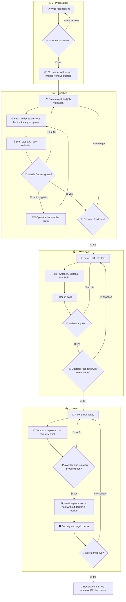

# 002 - Hosted Quality Scan

## User Story

As a person without a `quality` install or a CI pipeline, I want to submit a public repository URL, a file or pasted text to a hosted scan and read its report, so that I get the strict checks of requirement 001 without any setup, on a host that treats every submission as hostile.

## Decisions (operator-confirmed 2026-11-06; do not re-litigate)

1. **Static scan only**: the service runs `quality check --all --json` from requirement 001 and no target code: no install, no build, no test. Rejected: running the target's tests (installing dependencies already executes foreign code, so this would need its own requirement and isolation).
2. **Location**: the role lives at `ansible/roles/web-app-cst-quality-check/` and the web app at `service/web/`, in this repository and outside the `kvb-quality` package (001 decision 26). Core mounts the role into `<core>/roles` like `web-app-cst-security-check`, so core needs no commit. Every file is written anew under MIT, none is copied from core (001 decision 16). Rejected: a separate repository (the operator wants tool and role in one place).
3. **Inputs**: a public repository URL, one uploaded file, or pasted text with a chosen language. File and text are limited to `limits.upload_bytes`, initially 1 MiB, and `meta/server.yml` sets `client_max_body_size` next to it, because openresty otherwise buffers 100 MiB per anonymous request (`sys-svc-proxy/templates/location/html.conf.j2:18,39`). A URL means its default branch, fetched without credentials. An upload is one opaque file, and archives are never unpacked. Rejected: unpacking archives (bombs, crafted `.git`); choosing a branch or ref (pull request refs serve outsiders' code under the repository's name); private repositories (token handling, and CLI and CI cover them).
4. **Three tiers, two switches**: `access.anonymous` and `access.captcha` in `meta/services.yml` are on by default. With `access.anonymous` on, anyone may submit at `/` under a rate limit, plus a captcha while `access.captcha` is on. With it off, a scan is possible only after registration, and `/` holds no form. Any logged-in account submits at `/account/` without a captcha and under a per-user limit. Members of the role's RBAC group submit there without a quota. Members queue first, and `limits.concurrency` binds everybody: no quota means no refused submission, not unbounded parallel scans. Accepted limits: `access.anonymous` on with `access.captcha` off leaves the rate limits as the only brake; a registered account means one in the installation's Keycloak, and core sets `registrationAllowed: false` (`web-app-keycloak/templates/import/realm.json.j2:31`), so accounts come from an administrator until that realm-wide setting changes, which is outside this requirement. Rejected: onion access in this version (plain HTTP has no `crypto.subtle` for the captcha, and all onion visitors would share one rate limit bucket).
5. **Captcha**: while `access.captcha` is on, ALTCHA, a self-hosted proof of work under MIT, with no third-party request and no cookie. The role serves the external widget build with its worker from `'self'`, so core's CSP stays closed. The web app verifies solutions with the `altcha` library, requires a short `expires_at` and refuses a replay through a set kept under a lock. Accepted limits: a restart empties that set, so a solution can replay until it expires; proof of work raises a bot's cost and does not stop a determined attacker, so the rate limits and the capped anonymous queue bound the damage. Rejected: reCAPTCHA, hCaptcha and Turnstile (visitor data goes to a third party, and the CSP must open for it).
6. **Any public host, blocked at the network**: a URL may name any public host, the operator's pick, so no host allow-list protects the service. The fetch stage joins only a fixed-name `internal: true` network on a fixed subnet, without a bridge gateway address, whose only long-lived member is an egress proxy at a fixed address. `https_proxy` names that address, because gVisor on a bare host cannot reach Docker's embedded DNS (<https://gvisor.dev/docs/user_guide/faq/>), which docker-in-docker hides. The proxy is Squid 7 without a cache, with `dns_nameservers` set to reachable addresses, `pid_filename none`, `access_log none`, `cache_log` on stderr and one worker: it allows `CONNECT` to port 443 only, denies everything else, and checks the resolved address against `0.0.0.0/8`, `10.0.0.0/8`, `100.64.0.0/10`, `127.0.0.0/8`, `169.254.0.0/16`, `172.16.0.0/12`, `192.0.0.0/24`, `192.168.0.0/16`, `198.18.0.0/15`, `224.0.0.0/4`, `240.0.0.0/4`, `::/128`, `::1`, `fc00::/7`, `fe80::/10`, `ff00::/8` and the host's own addresses, rendered at each deploy. `::ffff:0:0/96` is left out, because Squid compares IPv4 addresses as IPv4-mapped IPv6, so that range matches every IPv4 address; a mapped internal target hits the IPv4 ranges instead (measured with `test_egress_*`, operator 2026-11-07). `negative_dns_ttl`, fixed in `squid.conf`, is documented as the lower limit on cached positive answers up to v7, which should hold a zero-TTL rebind between check and connection, and the build fails on Squid 8, which dropped it. `test_egress_rebinding` decides that across cache expiry, and a failure returns this decision to the operator. Git also runs with `GIT_ALLOW_PROTOCOL=https`, `http.followRedirects=false`, `transfer.fsckObjects=true` and a fixed `http.userAgent` naming an abuse contact. The URL validator requires a host name of at least two labels and rejects user info, ports other than 443, IP literals in any notation, query and fragment; single labels would otherwise resolve under `DOMAIN_PRIMARY` (`sys-svc-container/templates/daemon.json.j2:19-20`). Measured: default git follows a redirect to an internal listener and reaches a direct internal URL, and those git settings stop it; a public name resolving to a private address needs the proxy. A URL without `.git` is tried as given and then with `.git`, because a redirect is not followed. Accepted limits: the service can be pointed at any public HTTPS server, bounded by `per_host_hour` and the anonymous hourly total; an expiry race between check and connection is not excluded, and because git verifies TLS for the requested name, its worst case without an exploited fetch step is a TLS handshake with an internal port 443; concurrent fetches share the network, listen on nothing and hold no capability; Squid has a long vulnerability record, reachable only from a fetch stage that is already exploited, and it runs under decision 8 itself. Rejected: a host allow-list (the operator's pick); the guard of `security/src/relay.rs` (it pins DNS inside its own HTTP client, and git cannot); Smokescreen (the stock binary has no port limit and also proxies plain HTTP, so it needs an own Go wrapper); `DOCKER-USER` rules (need host firewall management and behave differently under docker-in-docker).
7. **One launcher, one container per step**: the web app has no container socket. A timer-driven `sys-service` unit on the host runs the launcher, as `sys-ctl-hlth-csp` does, with `system_service_id` set to the role name and one script of at most 500 lines (001 decision 13). It is Python with the standard library and passes arguments as lists, never through a shell. For each job it mounts a fresh tmpfs on the host with `size=`, `nr_inodes=`, `uid=65534`, `mode=0700` and `nosuid,nodev,noexec`, binds it into the steps and unmounts it afterwards. A URL job runs fetch steps on the egress network, a file or text job runs prepare steps with `--network none` that take the content on stdin and run `git init` and `git add` on the normalised name, and both end in the scan step. Each step's payload runs under `timeout` inside the container, because a deploy stops the unit (`sys-service/tasks/02_lockdown.yml:45-72`) and the client's death does not stop a container. The launcher reaps by label at start and on `SIGTERM`. The same unit also deletes expired reports and updates the database. Rejected: a local-driver tmpfs volume (read from moby's source, not run: it unmounts at zero references, which would lose the clone between steps); a long-lived worker polling for jobs (a hostile repository exploiting a parser would stay and take the next job, and could report anything); a socket in any container (core requirement 032 forbids the host socket for untrusted code). Exception for development only: the local stack of `make up` (`service/compose.yml`) runs the launcher as a container with the host socket and with database updates off (`database.update_hours: null` in `service/dev/config.json`), so it needs no host unit and no database download; the role never deploys it (operator, 2026-11-07).
8. **Sandbox is mandatory**: every step runs with `--read-only --user=65534 --cap-drop=ALL --security-opt=no-new-privileges --pids-limit= --memory= --cpus= --tmpfs=/tmp:size=` and `--runtime=` set to core's `SANDBOX_RUNTIME`, from the `svc-virt-kata` dependency. Scan and prepare steps add `--network=none`. Flags use the `--flag=value` form, the launcher scrubs its environment before calling core's `container` wrapper (`sys-svc-container/files/python/container.py:29-102,332-343`), no step receives an environment file, and `HOME` and `XDG_CACHE_HOME` point at `/tmp`. The launcher reads the installed runtimes from `docker info` and starts no job when `SANDBOX_RUNTIME` is not among them. The images come from role configuration and never from a job file. Rejected: the shared kernel (defensible behind a login, not for anonymous input).
9. **Reports are claims, not proof**: the launcher reads the scan's stdout up to `limits.report_bytes` and validates it against the fields of 001 decision 23. Exit 0 and 1 give `done`; anything else, including invalid output, gives `failed`, shown as not checked and never as clean. A compromised scan can falsify only its own report, and the submitter's `.qualityignore.yml` can silence rules, so each report lists the applied exclusions and there is no badge and no pass wording. Rejected: a badge (it would certify a result its subject controls).
10. **State on its own mount, without a database**: `spool/` and `reports/` sit on one tmpfs mount limited by `limits.state_bytes` and inodes, so a flood cannot fill the host's disk, a reboot empties them, and no backup sees them, since baudolo walks container volumes. An fstab entry mounts it before the container daemon starts, tmpfiles.d recreates both directories, and the web service binds them in long form with `create_host_path: false`, so a missing mount stops the service instead of pinning the root filesystem's directory. The web app mints the id, matching `^[0-9a-f]{32}$`, writes to `spool/` and binds `reports/` read-only. The spool is flat. The launcher opens entries through `dir_fd` with `O_NOFOLLOW|O_NONBLOCK`, checks `fstat` for a regular file, reads at most the limit plus one byte, renames the entry into a launcher-only directory before parsing, isolates each job in its own `try`, and takes at most `limits.jobs_per_run`. It writes a report as a temporary file plus `link`, so it never replaces one. A report is reached by its random 128-bit link, holds no user data, and has no listing. Rejected: PostgreSQL as in `security` decision 4 (a database credential on the host and migrations, for data that lives 48 hours); a plain host directory (the root filesystem would be the limit).
11. **Limits in `meta/services.yml`**: `retention_hours` is 48 and every other limit sits next to it: `rate_limits.anonymous_per_ip_hour`, `rate_limits.anonymous_hourly_total`, `rate_limits.per_host_hour`, `rate_limits.registered_per_user_hour`, the anonymous queue cap, upload size, repository size per tier, timeouts, concurrency, jobs per run, state size, session lifetime, database age. Reports older than `retention_hours` are deleted, and submitted content is deleted at the job's end and never served back. Rejected: 7 days (the operator's pick is 48 hours); values in code.
12. **Compose only**: `quality-check.modes.swarm.enabled` is `false`, and `tasks/00_core.yml` asserts `DEPLOYMENT_MODE == 'compose'`, because core reads that key for CI discovery and docs and refuses nothing at deploy time. `docker stack deploy` drops the per-service `runtime:` key, and the launcher is per node. Rejected: swarm now (isolation would move to node placement).
13. **Web app**: Flask under gunicorn with one worker process and threads, server-rendered with autoescaping, and no JavaScript except the captcha widget. It reads the client address only from `X-Real-IP` and refuses a request without it. Rate limit counters live in memory, keyed by an HMAC of the address or user name with a key rotated daily. A restart resets them. The vhost sets `access_log off` and `error_log /dev/null crit`, because core's formats store the address and the path, which holds the report link (`sys-svc-webserver-core/templates/nginx.conf.j2:45-50`). Handshake lines before SNI stay host-wide, and the privacy pages say so. `css`, `javascript`, `matomo`, `logout`, `dashboard` and `design` are off, as in `security/ansible/roles/web-app-cst-security-check/meta/services.yml:39-71`, because core otherwise injects them and Matomo would see report links. The web, scan and proxy images are built from Dockerfiles in this repository, Infinito.Nexus role compatible as in store and security (operator, 2026-11-07); the scan image takes its tools from `flake.lock` through a Nix build stage (001 decision 18). The web app reads one JSON configuration, `web.json` from the role or `service/dev/config.json` locally, instead of environment variables, so the role and the local stack share one schema (operator, 2026-11-07). Accepted limit: without an access log, abuse is visible only through rate limit refusals. Rejected: a single-page app (more surface for no gain).
14. **Database updates**: once a day the launcher runs `quality db update` in a one-shot container through the egress proxy, with no job mount, into a host directory outside the state mount. A failed update makes the unit fail after its jobs, which alerts through `SYS_SERVICE_ON_FAILURE_COMPOSE`. Past the age limit of 001 decision 24, jobs end as `failed: database too old`.
15. **Legal**: the role ships its own privacy and terms pages, naming what is processed and for how long. Only this repository's Semgrep rules run (001 decision 24). `kvb-check-legal` runs before go-live. Rejected: reusing the texts of `security` (a different service with different data).
16. **Native login, no trusted header**: the web app runs the authorization code flow with PKCE itself through `authlib`, and verifies the ID token's signature and claims with `joserfc`, both pinned to exact versions in `service/web/requirements.txt` (operator, 2026-11-07), on its own public Keycloak client (`services.sso.oidc.clients` and `templates/keycloak/clients.json.j2`, as `web-app-stalwart` does) with one redirect URI and the group claim's scope in `defaultClientScopes`, because the realm holds it as optional only. Keycloak's role creates that client, so a run adding this role to an existing realm must include `web-app-keycloak`. The web app verifies issuer, audience and nonce, and compares the group exactly against `/` plus `rbac_group_path` of the role `member`, because the claim holds a leading slash and the lookup does not. It keeps only the user name and the member flag in process memory under a random session cookie set after login, so a restart logs everyone out, and it expires a session after `limits.session_hours`, because a group removal reaches a running session only then. State, nonce and PKCE verifier stay in process memory under a short-lived `__Host-` cookie set only on `/account/login`, which binds the flow to the browser. It trusts no identity header on any path. `/account/logout` ends the session in the app and sends the browser to Keycloak's end-session endpoint with `client_id`. Accepted limit: without an ID token Keycloak may ask for confirmation. Rejected: the `oauth2` sidecar (without `allowed_groups` it requests no group claim and admits only `DOMAIN_PRIMARY` mail addresses, with them it refuses accounts outside the group, `web-app-keycloak/templates/sso_proxy/oauth2-proxy-keycloak.cfg.j2:30-38`, and its headers need a proxy secret plus lints only the IAM line has); core's shared client (its secret would sit in a container anonymous visitors reach).
17. **Test configurations**: temporary git servers have private addresses that the production proxy refuses. Tests marked `[test proxy]` therefore run with an allow-listed configuration of their own. Every `test_egress_*` runs the production deny list. Tests marked `[internet]` need outbound access and are skipped offline with a visible reason. Accepted limit: `[test proxy]` tests prove git's behaviour, not the proxy's.

## Approach

## Acceptance Criteria

### Role

- [ ] `ansible/roles/web-app-cst-quality-check/` holds `meta/main.yml`, `meta/domains.yml`, `meta/networks.yml`, `meta/services.yml`, `meta/server.yml`, `meta/rbac.yml`, `meta/volumes.yml`, `meta/csp.yml`, `meta/variants.yml`, `vars/main.yml`, `tasks/main.yml`, `tasks/00_core.yml`, `templates/compose.yml.j2`, `templates/keycloak/clients.json.j2`, `files/python/script.py` and `files/playwright/playwright.spec.js`.
- [ ] `vars/main.yml` sets `application_id: "web-app-cst-quality-check"` and `system_service_id` to the same value.
- [ ] `wc -l files/python/script.py` is at most 500.
- [ ] `meta/domains.yml` declares `quality.{{ DOMAIN_PRIMARY }}` as canonical domain.
- [ ] `meta/services.yml` declares `sso.flavor: oidc` and `sso.oidc.clients`, and `templates/keycloak/clients.json.j2` defines one public client with `S256` PKCE, `/account/callback` as its only redirect URI, `post.logout.redirect.uris`, and `{{ KEYCLOAK_RBAC_GROUP_CLAIM }}` in `defaultClientScopes`.
- [ ] `meta/rbac.yml` names the role `member`, and `web.json`, which `tasks/00_core.yml` writes from `QUALITY_CHECK_WEB_CONFIG` and `meta/volumes.yml` mounts read-only, passes `/` plus its `rbac_group_path` to the web app and holds no client secret.
- [ ] `meta/variants.yml` deploys the role once with both switches on and once with `access.anonymous: false`.
- [ ] `rg -ni "x-forwarded-user|x-forwarded-groups|x-remote-user" service/web ansible/roles/web-app-cst-quality-check` finds nothing.
- [ ] `meta/services.yml` sets `quality-check.modes.swarm.enabled: false`, `retention_hours: 48`, `access.anonymous: true`, `access.captcha: true`, and `css`, `javascript`, `matomo`, `logout`, `dashboard`, `design` and `tor` disabled.
- [ ] `test_deploy_refuses_swarm`: `tasks/00_core.yml` fails under `DEPLOYMENT_MODE=swarm`, naming the mode.

### Inputs

- [ ] `test_url_validation`: web app and launcher each accept `https://example.org/a/b` and reject `http://`, `ssh://`, `file://`, `ext::`, a plain path, user info, a port other than 443, an IPv4 literal, an IPv6 literal, `2130706433`, `0x7f.1`, a single label, a query, a fragment and a leading `-`.
- [ ] `test_launcher_revalidates`: a job file placed directly into the spool with an invalid URL never reaches git.
- [ ] `test_prepare_step`: a file job and a text job reach the scan through a `--network=none` prepare step, and `git ls-files` lists exactly the normalised name.
- [ ] `test_upload_opaque`: an uploaded ZIP is scanned as one file, and a canary inside it appears nowhere.
- [ ] `test_text_language`: pasted Python text with language `python` is scanned as `snippet.py` and reports a known `ruff` rule.
- [ ] `test_filename_normalised`: uploads named `../../x.py`, `.git/config` and `a<newline>b.py` each become one safe base name.
- [ ] `test_submission_deleted`: after a job, no file on the state mount or the job's mount holds the submitted content.

### Access

- [ ] `test_anonymous_needs_captcha`: with `access.captcha` on, a missing, invalid, expired or replayed solution creates no job.
- [ ] `test_captcha_switch`: with `access.captcha` off, an anonymous submission needs no solution, no page loads the widget, and the rate limit still answers 429.
- [ ] `test_registration_required`: with `access.anonymous` off, `/` holds no form, an anonymous `POST` creates no job, and a logged-in account's submission at `/account/` is accepted.
- [ ] `test_registered_rate_limit`: an account outside the group needs no captcha, and its submission over `registered_per_user_hour` answers 429.
- [ ] `test_anonymous_rate_limit`: the submission over the limit from one address answers 429, another address passes, and one IPv6 `/64` counts as one address.
- [ ] `test_anonymous_hourly_total`: submissions from different addresses above `anonymous_hourly_total` answer 429, and a member's is accepted.
- [ ] `test_target_host_limit`: URL jobs for one host above `per_host_hour` answer 429 for anonymous submitters.
- [ ] `test_anonymous_queue_cap`: with a full anonymous queue an anonymous submission answers 429 and a member's is accepted.
- [ ] `test_member_no_quota`: a group member submits more jobs than every other tier's limit without a captcha, and all are accepted.
- [ ] `test_member_first`: a queued member job starts before an older job of any other tier.
- [ ] `test_forged_identity`: a user or group header grants no logged-in tier on any path, and an unknown session cookie counts as anonymous.
- [ ] `test_token_checks`: an ID token with a wrong issuer, audience or nonce is refused, one holding the slash-prefixed group path gives the member tier, and one without it gives the registered tier.
- [ ] `test_session_cookie`: after login the cookie is `HttpOnly`, `Secure` and `SameSite=Lax` and holds no token, and an anonymous visit sets no cookie.
- [ ] `test_foreign_origin_refused`: a logged-in `POST` with a foreign `Origin` creates no job.
- [ ] `test_logout`: after `/account/logout` the old cookie grants no logged-in tier, and the browser was sent to the end-session endpoint.
- [ ] `test_session_expires`: a session older than `limits.session_hours` grants no logged-in tier.
- [ ] `test_login_state_bound`: a callback whose state belongs to another browser's login cookie is refused.
- [ ] `test_missing_real_ip`: a request without `X-Real-IP` is refused.

### Fetch and egress

- [ ] `test_fetch_argv`: the clone runs with `https_proxy` set to the proxy's fixed address, `no_proxy`, `NO_PROXY` and `all_proxy` absent, `GIT_ALLOW_PROTOCOL=https`, `GIT_TERMINAL_PROMPT=0`, `http.followRedirects=false`, `transfer.fsckObjects=true`, the fixed `http.userAgent`, empty global and system configuration, `--depth 1 --no-checkout --single-branch`, and `--` before the URL.
- [ ] `test_egress_blocks_internal`: from the fetch network, a name resolving into each range of decision 6 and each of the host's own addresses is refused by the proxy.
- [ ] `test_egress_rebinding`: with a stub DNS server answering first a public and then a private address at TTL 0, the private listener sees zero hits in repeated connections across the cache's expiry.
- [ ] `test_proxy_flags`: `docker inspect` of the proxy shows every setting of decision 8 except `--network=none`.
- [ ] `test_proxy_version`: the flake build fails when Squid's major version is not 7.
- [ ] `test_egress_no_direct_route`: from the fetch network, a direct connection that skips the proxy fails, to a public address, to the bridge's gateway address and to the host.
- [ ] `test_egress_connect_only`: plain `GET http://` through the proxy is refused.
- [ ] `test_egress_port_443_only` `[internet]`: `CONNECT` to a public host on port 80 or 25 is refused, and on port 443 it succeeds.
- [ ] `test_redirect_not_followed` `[test proxy]`: a server redirecting to a canary listener causes zero hits there.
- [ ] `test_submodule_not_fetched` `[test proxy]`: a `.gitmodules` pointing at a canary listener causes zero hits there.
- [ ] `test_index_populated` `[test proxy]`: after the fetch, `git ls-files` equals `git ls-tree -r --name-only HEAD`.
- [ ] `test_fetch_visible_in_scan` `[test proxy]`: the scan step sees every file the fetch step wrote.
- [ ] `test_repo_too_large` `[test proxy]`: a repository over the tier's size limit ends as `failed: too large`, and its mount is gone.
- [ ] `test_fetch_timeout` `[test proxy]`: a server that stalls ends as `failed: timeout`, and no container remains.
- [ ] `test_private_same_as_missing` `[test proxy]`: a private and a missing repository yield the same `failed: not reachable`.

### Launcher and isolation

- [ ] `test_no_runtime_no_job`: with `SANDBOX_RUNTIME` absent from the runtimes of `docker info`, the launcher exits non-zero and starts no container.
- [ ] `test_stage_flags`: through core's real `container` wrapper, with `CA_CONTAINER_ENABLED=1` in the calling environment, each step's container shows in `docker inspect` every setting of decision 8, read-only job and database mounts in the scan step, and no credential in its environment.
- [ ] `test_image_not_from_job`: a job file naming an image has no effect on the image started.
- [ ] `test_isolation_probe`: a probe image, set through the launcher's test configuration, reaches no network, cannot write `/src` or `/db`, sees no other job's mount, hits the process limit on a fork bomb and the size limit on `/tmp`.
- [ ] `test_probe_cannot_stay`: a probe that never exits is killed at the timeout, no container remains, and the next job starts in a new container.
- [ ] `test_job_separation`: a file left by job A's probe is absent in job B.
- [ ] `test_stop_mid_job`: after `systemctl stop` during a job, the next run leaves no step container and no job mount, and the job shows `failed`.
- [ ] `test_launcher_recovers`: after `kill -9` during a job, the next run marks it `failed` and removes its container and mount.
- [ ] `test_spool_hostile_file`: a symlink, a FIFO, a directory and an oversized file in the spool are skipped without blocking the run, and no target is read.
- [ ] `test_job_id_hostile`: ids holding `../`, a leading `-` or uppercase hex are refused, and no path, container or mount is created from them.
- [ ] `test_report_no_overwrite`: a job naming an existing report's id leaves that report unchanged.
- [ ] `test_poison_job_isolated`: a job file with deeply nested JSON fails alone, and the next job in the same run completes.
- [ ] `test_spool_full`: with the state mount full, an anonymous submission answers 429, the launcher still marks running jobs, and the host's root filesystem is unchanged.
- [ ] `rg -n "shell=True|os\.system" ansible/roles/web-app-cst-quality-check/files/python/` finds nothing.

### Reports

- [ ] `test_report_schema`: a probe printing an unknown field, invalid JSON or more than the size limit ends as `failed`.
- [ ] `test_exit_mapping`: exit 0 and 1 give `done`; exit 2, a signal and a timeout give `failed` with no findings, shown as not checked.
- [ ] `test_report_header`: a URL report shows commit, `quality` version, database date and digest, `HEAD only: history not scanned` and the applied exclusions.
- [ ] `rg -ni "badge" service/web` finds nothing.
- [ ] `test_report_escaped`: a path holding `<script>` renders as text and is no link.
- [ ] `test_report_link`: report ids hold 128 random bits, an unknown id answers 404, no route lists reports, and pages send `Referrer-Policy: no-referrer` and `X-Robots-Tag: noindex`.
- [ ] `test_no_personal_data`: a report file holds no address, user name or email.
- [ ] `test_canary_end_to_end`: a canary secret in a fixture repository is absent from the report, the state mount, the launcher's journal and the web app's log.

### Retention and database

- [ ] `test_retention`: with `retention_hours: 1`, a report older than one hour is deleted and a younger one stays.
- [ ] `test_db_update_isolated` `[internet]`: the update container mounts no job directory and reaches the network only through the proxy.
- [ ] `test_db_update_failure_alerts`: a failed update completes queued jobs first and then makes the unit fail.
- [ ] `test_db_too_old_job_fails`: a database past the age limit ends jobs as `failed: database too old`.

### Legal

- [ ] `files/legal/en/privacy.html`, `files/legal/de/privacy.html`, `files/legal/en/terms.html` and `files/legal/de/terms.html` exist, and the privacy pages state the retention value from `meta/services.yml`.
- [ ] A notices page lists every bundled tool with its licence.
- [ ] `docs/review/002-go-live.md` records the `kvb-check-legal` and `kvb-check-security` results of the go-live commit with no open critical finding.

### Tests

- **Unit**
  - [ ] `make test-unit` covers the URL validator, the job parser, the report schema, the rate limiter and captcha verification.
- **Integration**
  - [ ] `make test-integration` runs every named test above except the E2E ones against real containers, the real proxy and temporary git servers, and it reports each skipped `[internet]` test by name.
- **E2E**
  - [ ] `make compose-deploy apps=web-app-cst-quality-check` from core with this role mounted ends green.
  - [ ] `test_live_no_socket`: on the deployed stack, `docker inspect` shows no container socket mount and exactly the role's own network on the web service.
  - [ ] `test_live_fetch_network`: `docker network inspect` shows the fetch network with its fixed name, `internal: true`, no gateway address and the proxy as the only long-lived member.
  - [ ] `test_reboot_state_mount`: with the state mount absent the web service does not start and nothing is written below the mount point on the root filesystem; after `mount -a` and `systemd-tmpfiles --create` it starts and both directories are writable.
  - [ ] `test_add_to_existing_realm`: on a stack whose realm already exists, a run adding this role with `web-app-keycloak` creates the client, and a group member logging in gets the member tier from a real token.
  - [ ] `test_upload_too_large`: through real openresty, an upload over the limit is refused, and no job or spooled body remains.
  - [ ] `test_forwarded_for_ignored`: through real openresty, a client-sent `X-Forwarded-For` or `X-Real-IP` does not change the rate limit bucket.
  - [ ] `test_no_address_on_disk`: after rate-limited submissions, an aborted report fetch and a 413, neither the web app's files nor openresty's container log holds the client address or a report id.
  - [ ] The Playwright spec submits this repository's public URL, a file and pasted text anonymously and reads each report, submits at `/account/` as a group member beyond the per-user limit and as an account outside the group up to that limit, and finds no form at `/` in the `access.anonymous: false` variant.
  - [ ] Playwright sees a rendered CSP that allows the widget's worker from `'self'`, the captcha solved under it, and zero cross-origin requests on `/` and on a report page.
  - [ ] Deep tier findings under `SANDBOX_RUNTIME` match the host binary's on one database digest.
  - [ ] `test_isolation_probe`, `test_stop_mid_job`, every `test_egress_*` and one URL job also pass on a host without docker-in-docker, with each runtime that host offers.
