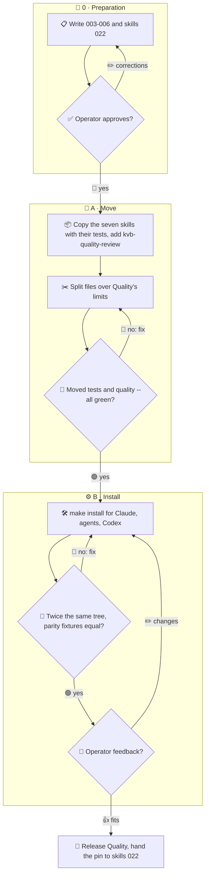

# 003 - Analysis Skills in Quality

## User Story

As the operator, I want every analysis skill of the skills repository (scans, scoring, measuring) to live in Quality as `/kvb-quality-*`, installed by Quality itself, so that each analysis has one source (SPOT), Quality owns analysis and the skills repository only orchestrates (SRP).

## Decisions (operator-confirmed 2026-11-18; do not re-litigate)

1. **Scope: analysis only**: these move, renamed: `kvb-check-security` → `kvb-quality-security`, `kvb-check-legal` → `kvb-quality-legal`, `kvb-check-principles` → `kvb-quality-architecture`, `kvb-check-score` → `kvb-quality-score`, `kvb-check-confidence` → `kvb-quality-confidence`, `kvb-check-break-risk` → `kvb-quality-break-risk`, and the CPU, RAM and wall-clock half of `kvb-check-efficiency` (`measure.py`, which absorbed `kvb-check-speed` in skills 0fad1bf) → `kvb-quality-performance` (operator 2026-11-26: one skill under the more telling name, replacing `kvb-quality-speed` and `kvb-quality-efficiency`). The token half of `kvb-check-efficiency` (`tokens.py`) and the commit-block check `block.py` stay in skills, since they run skills' `gate.py` (skills 022 decision 10). Rejected: moving `kvb-code-*` (they change code; Quality only analyses); moving `kvb-check-gate` (operator 2026-11-18: it runs queue holds, writes the register and calls `kvb-git-hotfix`, which call it back, so the move would tie both repositories into one release cycle; it stays in skills as `kvb-org-gate`, skills 022). Operator 2026-11-26: an eighth folder, the new skill `kvb-quality-review`, joins them (decision 9); it was planned as its own requirement 007 and merged here. Operator 2026-11-27: a ninth, `kvb-quality-audit`, joins them by requirement 011 decision 1.
2. **Same schema as the skills repository**: `skills/<name>/SKILL.md` with `name` and `description` frontmatter, helper files beside it, scripts under `scripts/`, tests under `tests/`; the description budget, frontmatter, ruff, shellcheck and markdownlint checks of the skills repository run here too.
3. **Own installer**: `make install` installs these skills into `~/.claude/skills`, `~/.agents/skills` and, when `~/.codex` exists, `~/.codex/skills`, as the skills repository's `scripts/install.sh` does; the skills installer only triggers it (skills 022). Rejected: the skills repository copying Quality's files (two installers for one tree).
4. **No redirects**: the old names disappear in the same release pair and every caller is renamed (skills 022). Rejected: one-line redirect skills.
5. **State paths unchanged**: `~/.local/state/agents-shared/security-accepted.jsonl`, scan caches and evidence keep their paths, so accepted findings and cached runs survive the move.
6. **Quality's own limits apply**: every moved file passes `quality --all` (500 lines per file, 12 items per folder); a file over a limit is split before it moves.
7. **Tools**: the scripts take their tools (MEDUSA, ruff, lizard, jscpd) from Quality's pinned tool set when present, else from PATH, and name the one that ran.
8. **One-way dependency, helpers in Quality's package** (operator 2026-11-18): skills depends on Quality, Quality never on skills, and no helper exists twice. The helpers the moved scripts need leave skills and become one stdlib-only subpackage `quality.agent` of Quality's Python package: `nofollow` (safe reads and writes, today `kvb-org-organize/scripts/nofollow.py`), `state` (the council-root rule, `AGENTS_COUNCIL_ROOT` else `$XDG_STATE_HOME/agents-shared`, and the names of the accepted-findings ledger and the score journal), `diff` (the lines a git diff adds per file, for the moved scripts that report on changed lines only, today inside `kvb-code-clean/scripts/defaults.py`); added 2026-11-26: `ledger` (the accepted-findings fingerprint, row format and twin rule that `kvb-quality-security` and `kvb-quality-review` share) and `score` (the value markers and percent parser that `kvb-quality-score` and skills' `block.py` share). `kvb-code-clean/scripts/defaults.py` does not move: Quality's rule `clean.default-value` already does that analysis (the recall bench measures it against `defaults.py`), so it becomes the only defaults check; the moved scripts use it, the bench bound rises from 0.95 to 1.0 on core before `defaults.py` leaves skills, and the bench then reads a frozen hit list instead of the script. `quality.agent` joins `packages` in `pyproject.toml`, and the reason of the `clean.folder-items` waiver for `src/quality` in `.qualityignore.yml` names it. `make install` installs the checkout itself (`pip install --no-deps .`) into Quality's own venv (`~/.local/share/kvb-quality/venv`), so the venv equals the released package, and writes `~/.local/bin/kvb-quality-python`, a wrapper that execs the venv's interpreter (amended 2026-11-26: a linked interpreter does not activate the venv, measured `sys.prefix` `/usr`); the moved scripts start with `#!/usr/bin/env kvb-quality-python`. Skills uses the same interpreter (skills 022). Rejected: the shared install root (Quality would call skills); a copy in each repository (two sources for one fact); a lib folder in every install root (three copies on disk, a folder without `SKILL.md`).
9. **Review base** (operator 2026-11-26): `kvb-quality-review` runs every measurable check Quality owns on one target and prints one JSON; it is the base the skills wrapper `kvb-code-review` calls (skills 064), which adds the repository standards, the harness review skills, skeptics, the push stamp and the hook. `scripts/review.py --repo <root> (--base <ref> | --staged | --range <a>..<b> | --all) [--path <file>]... [--db <dir>] [--measure] --json`. By default it runs `quality check`'s fast tier, the deep tier only with `--db` (else a `skipped` entry with the reason), and the lenses `security`, `legal` and `architecture`; the lens `performance` only with `--measure`, since it needs a base measurement, and it fills the scores `efficiency` and `speed` that `kvb-quality-score` takes; `break_risk` and `confidence` are judgements, so they stay `null` with a `skipped` entry naming `kvb-quality-break-risk` and `kvb-quality-confidence`, and 064 fills them. Output: `{"findings": [{"lens", "rule", "severity", "path", "line", "message", "commit", "tier", "blob"}], "scores": {"security", "legal", "architecture", "break_risk", "confidence", "efficiency", "speed"}, "lenses": {"<lens>": "<tool and rule-set version>"}, "ran": ["<lens>"], "skipped": [{"lens", "reason"}]}`; `blob` is the file's blob hash at the target and `commit` names the commit of a history finding, so 064 can cache per lens, lens version, path, blob hash and standards digest (skills 064 decision 13). A repeatable `--path` limits every lens to those files. Exit codes as `quality check`: 0 clean, 1 findings, 2 usage or tool error. `.qualityignore.yml` and folder `.nocheck` apply through `quality check`; the other lenses honour the shared accepted-findings ledger. Rejected: its own requirement 007 (operator: one move, one requirement); exit 0 with findings in the JSON (operator: one contract with `quality check`); running the deep tier and `performance` on every call (slow, and a missing database would end every review).
10. **Exception comments, a soft rule** (operator 2026-11-26): narrative comments are forbidden, `Exception:` ones too; why the code is shaped this way goes into the commit body. `Exception:` stays a marker for a real exception only, a concrete trip-wire the code cannot show. `kvb-quality-review` ships `scripts/exceptions.py --repo <root> (--staged | --base <ref>) [--confirm <path>:<line>]...`: it lists every Exception comment the change adds and exits 1 until each listed line is confirmed, so the agent confirms each one explicitly; exit 0 when none is left, 2 on a usage or git error. Rejected: `clean.comment` refusing every `Exception:` comment (operator: a real exception stays allowed as a marker).

## Approach

## Acceptance Criteria

### Move

- [x] `ls skills` lists exactly the nine `kvb-quality-*` folders of decisions 1 and 9 and requirement 011.
- [x] `grep -rnE 'kvb-(org|code|git|skill|think|agent|match|coach|dream|release)-' skills src` prints nothing: no moved file loads, runs or names a skill of the skills repository.
- [ ] `grep -c 'def open_below' src/quality/agent/nofollow.py` prints 1, and the skills repository defines it nowhere (skills 022).
- [x] `tests/bench/test_recall.py` passes with `RECALL = 1.0` on core, then reads its reference from a committed hit list, and `QUALITY_DEFAULTS_SCRIPT` is gone from the `Makefile`.
- [x] Every `SKILL.md` frontmatter `name` equals its folder name.
- [x] The first commit of the move names the skills commit the files came from. Amended 2026-11-26 (operator): the move landed as `6861dd6`, whose body does not name it; its source is skills `ff9bbc19c2`.
- [x] `quality --all` reports no hit in `skills/` and `tests/`.

### Install

- [x] After `make install`, `~/.claude/skills/kvb-quality-score/SKILL.md` and `~/.agents/skills/kvb-quality-score/SKILL.md` exist.
- [x] A second `make install` changes no file: `sha256sum` over `~/.claude/skills/kvb-quality-*` is equal before and after.
- [x] Without `~/.codex`, no `~/.codex/skills` is created.
- [x] After `make install`, `kvb-quality-python -c 'import quality.agent.nofollow, quality.agent.state, quality.agent.diff'` exits 0, and `head -n1` of every moved script prints `#!/usr/bin/env kvb-quality-python`.

### Parity

- [x] At the move commit, `kvb-quality-score/scripts/score.py` prints, for the fixtures of the last skills `tests/test_score.py`, the lines `kvb-check-score` printed there; from 006 on, its goldens replace this check.
- [x] `kvb-quality-security/scripts/security.py --json` on a fixture repository returns the findings `kvb-check-security` returned and honours the shared accepted-findings ledger.

### Review

- [x] `review.py --staged --json` on a fixture repository with one unused Python import prints one finding with lens `quality`, rule `coding.unused-import`, tier `fast` and the file's blob hash, and exits 1; after the fix it prints `"findings": []` and exits 0.
- [x] Without `--db`, `skipped` holds the deep tier with its reason; with a fixture database, `ran` names it.
- [x] `scores.break_risk` and `scores.confidence` are `null`, and `skipped` names `kvb-quality-break-risk` and `kvb-quality-confidence`; without `--measure`, `efficiency` and `speed` are `null` too.
- [x] `--path a.py` reports no finding outside `a.py`.
- [x] `lenses` maps every lens in `ran` to its tool and rule-set version.
- [x] A finding waived by a folder `.nocheck` or `.qualityignore.yml` is absent, and so is a security finding listed in the accepted-findings ledger.
- [x] `--range a..b` reports a secret that a commit in the range added and a later one removed, with that commit.
- [x] Two modes, or an unknown option, exit 2.
- [x] `exceptions.py --staged` on a fixture repository whose index adds `# Exception: x` prints `<path>:<line>: # Exception: x` and the question, and exits 1; with `--confirm <path>:<line>` it exits 0; `Exception` in code or on an unchanged line is not listed.

### Tests

- **Unit**: the moved unit tests of all eight skills pass with `make test-unit`, together with `review.py` argument parsing, JSON shape and exit codes and `exceptions.py`; negative controls: a wrong frontmatter `name` fails the frontmatter test, and a finding outside `--path` fails the path test.
- **Integration**: `make test-integration` installs into a temporary `HOME` twice and checks decision 3 and the idempotence criterion, and a fixture repository runs all default lenses through `review.py`.
- **E2E**: n/a: no page; skills 022 covers the install from the skills repository end to end.
