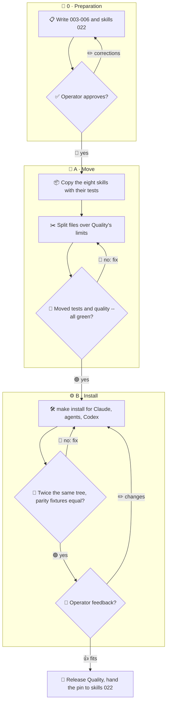

# 003 - Analysis Skills in Quality

## User Story

As the operator, I want every analysis skill of the skills repository (scans, scoring, measuring) to live in Quality as `/kvb-quality-*`, installed by Quality itself, so that each analysis has one source (SPOT), Quality owns analysis and the skills repository only orchestrates (SRP).

## Decisions (operator-confirmed 2026-11-18; do not re-litigate)

1. **Scope: analysis only**: these move, renamed: `kvb-check-security` → `kvb-quality-security`, `kvb-check-legal` → `kvb-quality-legal`, `kvb-check-principles` → `kvb-quality-architecture`, `kvb-check-score` → `kvb-quality-score`, `kvb-check-confidence` → `kvb-quality-confidence`, `kvb-check-break-risk` → `kvb-quality-break-risk`, `kvb-check-speed` → `kvb-quality-speed`, and the CPU and RAM half of `kvb-check-efficiency` → `kvb-quality-efficiency`. Rejected: moving `kvb-code-*` (they change code; Quality only analyses); moving `kvb-check-gate` (operator 2026-11-18: it runs queue holds, writes the register and calls `kvb-git-hotfix`, which call it back, so the move would tie both repositories into one release cycle; it stays in skills as `kvb-org-gate`, skills 022).
2. **Same schema as the skills repository**: `skills/<name>/SKILL.md` with `name` and `description` frontmatter, helper files beside it, scripts under `scripts/`, tests under `tests/`; the description budget, frontmatter, ruff, shellcheck and markdownlint checks of the skills repository run here too.
3. **Own installer**: `make install` installs these skills into `~/.claude/skills`, `~/.agents/skills` and, when `~/.codex` exists, `~/.codex/skills`, as the skills repository's `scripts/install.sh` does; the skills installer only triggers it (skills 022). Rejected: the skills repository copying Quality's files (two installers for one tree).
4. **No redirects**: the old names disappear in the same release pair and every caller is renamed (skills 022). Rejected: one-line redirect skills.
5. **State paths unchanged**: `~/.local/state/agents-shared/security-accepted.jsonl`, scan caches and evidence keep their paths, so accepted findings and cached runs survive the move.
6. **Quality's own limits apply**: every moved file passes `quality --all` (500 lines per file, 12 items per folder); a file over a limit is split before it moves.
7. **Tools**: the scripts take their tools (MEDUSA, ruff, lizard, jscpd) from Quality's pinned tool set when present, else from PATH, and name the one that ran.
8. **One-way dependency, helpers in Quality's package** (operator 2026-11-18): skills depends on Quality, Quality never on skills, and no helper exists twice. The helpers the moved scripts need leave skills and become one stdlib-only subpackage `quality.agent` of Quality's Python package: `nofollow` (safe reads and writes, today `kvb-org-organize/scripts/nofollow.py`), `state` (the council-root rule, `AGENTS_COUNCIL_ROOT` else `$XDG_STATE_HOME/agents-shared`, and the names of the accepted-findings ledger and the score journal), `diff` (the lines a git diff adds per file, for the moved scripts that report on changed lines only, today inside `kvb-code-clean/scripts/defaults.py`). `kvb-code-clean/scripts/defaults.py` does not move: Quality's rule `clean.default-value` already does that analysis (the recall bench measures it against `defaults.py`), so it becomes the only defaults check; the moved scripts use it, the bench bound rises from 0.95 to 1.0 on core before `defaults.py` leaves skills, and the bench then reads a frozen hit list instead of the script. `quality.agent` joins `packages` in `pyproject.toml`, and the reason of the `clean.folder-items` waiver for `src/quality` in `.qualityignore.yml` names it. `make install` installs the checkout itself (`pip install --no-deps .`) into Quality's own venv (`~/.local/share/kvb-quality/venv`), so the venv equals the released package, and links its interpreter as `kvb-quality-python` into `~/.local/bin`; the moved scripts start with `#!/usr/bin/env kvb-quality-python`. Skills uses the same interpreter (skills 022). Rejected: the shared install root (Quality would call skills); a copy in each repository (two sources for one fact); a lib folder in every install root (three copies on disk, a folder without `SKILL.md`).

## Approach

## Acceptance Criteria

### Move

- [ ] `ls skills` lists exactly the eight `kvb-quality-*` folders of decision 1.
- [ ] `grep -rnE 'kvb-(org|code|git|skill|think|agent|match|coach|dream|release)-' skills src` prints nothing: no moved file loads, runs or names a skill of the skills repository.
- [ ] `grep -c 'def open_below' src/quality/agent/nofollow.py` prints 1, and the skills repository defines it nowhere (skills 022).
- [ ] `tests/bench/test_recall.py` passes with `RECALL = 1.0` on core, then reads its reference from a committed hit list, and `QUALITY_DEFAULTS_SCRIPT` is gone from the `Makefile`.
- [ ] Every `SKILL.md` frontmatter `name` equals its folder name.
- [ ] The first commit of the move names the skills commit the files came from.
- [ ] `quality --all` reports no hit in `skills/` and `tests/`.

### Install

- [ ] After `make install`, `~/.claude/skills/kvb-quality-score/SKILL.md` and `~/.agents/skills/kvb-quality-score/SKILL.md` exist.
- [ ] A second `make install` changes no file: `sha256sum` over `~/.claude/skills/kvb-quality-*` is equal before and after.
- [ ] Without `~/.codex`, no `~/.codex/skills` is created.
- [ ] After `make install`, `kvb-quality-python -c 'import quality.agent.nofollow, quality.agent.state, quality.agent.diff'` exits 0, and `head -n1` of every moved script prints `#!/usr/bin/env kvb-quality-python`.

### Parity

- [ ] At the move commit, `kvb-quality-score/scripts/score.py` prints, for the fixtures of the last skills `tests/test_score.py`, the lines `kvb-check-score` printed there; from 006 on, its goldens replace this check.
- [ ] `kvb-quality-security/scripts/security.py --json` on a fixture repository returns the findings `kvb-check-security` returned and honours the shared accepted-findings ledger.

### Tests

- **Unit**: the moved unit tests of all eight skills pass with `make test-unit`; negative control: a wrong frontmatter `name` fails the frontmatter test.
- **Integration**: `make test-integration` installs into a temporary `HOME` twice and checks decision 3 and the idempotence criterion.
- **E2E**: n/a: no page; skills 022 covers the install from the skills repository end to end.
