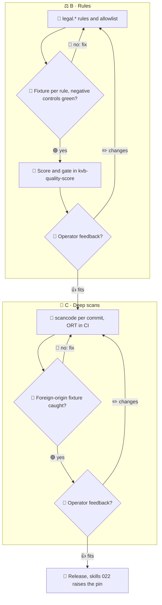

# 004 - Legal Score

## User Story

As the operator, I want each commit to show a ⚖️ legal score from licence and data-flow checks plus the legal review, so that an incompatible licence, a missing attribution or a new external request is caught before it is distributed.

## Decisions (operator-confirmed 2026-11-18; do not re-litigate)

1. **Stage B: rule family `legal.*`**: `legal.license-declared` (a LICENSE exists; manifest licence fields and SPDX headers agree with it), `legal.vendored-license` (every vendored or third-party folder named in `.quality/legal.yml` holds a licence file), `legal.dependency-license` (an added or changed dependency in a manifest or lockfile carries an allowlisted licence), `legal.external-request` (a new CDN, web font, analytics, embed or third-party API URL in code or templates), `legal.reuse` (`reuse lint`, only for repositories that opt into REUSE). Tools: `reuse`, `rg` and lockfile metadata; own code stays rule data (001 decision 2).
2. **Stage C**: `scancode-toolkit` detects licence texts and foreign copyright lines in changed files (`legal.foreign-origin`); OSS Review Toolkit evaluates the full dependency tree in CI on the default branch. Rejected for per-commit runs: ORT (minutes per run).
3. **Allowlist is SPOT, keyed by the project licence**: `rules/legal.yml` holds one default allowlist per project licence that `legal.license-declared` reads (for an MIT project: MIT, BSD-2-Clause, BSD-3-Clause, Apache-2.0, ISC, MPL-2.0, 0BSD, CC0-1.0; a GPL-3.0 project also allows LGPL and GPL-3.0); a repository narrows or widens its default in `.quality/legal.yml`. An undeclared or unknown project licence leaves every dependency `unchecked` (decision 8). A build- or test-only dependency that is never distributed is exempt.
4. **Weights like security**: blocker 50 (an incompatible distributed licence, a vendored file without licence, foreign code under an incompatible licence), finding 25 (missing attribution, NOTICE or header; a new external request; missing REUSE data in an opted-in repository), note 0. ⚖️ = 100 minus the sum, at least 0.
5. **Review on top**: `kvb-quality-legal` runs `quality --staged --json` for `legal.*` first, then its `checks.md` review only for what no tool sees (origin of a pasted block, personal data, trademarks); a value that includes review findings carries the `~` mark.
6. **Accepted false positives**: as for security: `accept` with rule, path, sha1, line and reason, only after an independent review judged the hit a false positive or by design (in skills: `kvb-think-criticize`; Quality's own texts name no skills skill, 003 decision 8); the commit message names each.
7. **Gate like security**: a blocker forbids the commit (exit 4); ⚖️ below 100 asks the operator (exit 3).
8. **Licence source**: most lockfiles carry no licence field and the scan runs offline, so `quality db update` stores registry licence metadata (PyPI, npm and the other ecosystems Quality bundles) in the offline bundle. A dependency without licence data there is `unchecked`: a note naming it, and the ⚖️ value carries the `~` mark; it never counts as clean. Rejected: installing packages for trivy licence scanning per commit (slow, needs network).

## Approach

## Acceptance Criteria

### Rules

- [ ] `rules/legal.yml` defines the five stage-B ids of decision 1 with tool and severity.
- [ ] A fixture adding an Apache-2.0 runtime dependency to an MIT project gives no hit; one adding a GPL-3.0 runtime dependency gives one `legal.dependency-license` blocker; the same GPL-3.0 dependency in a GPL-3.0 project gives no hit.
- [ ] A fixture dependency without licence data in the bundle gives one `unchecked` note, `legal_unchecked` 1 and a ⚖️ value with `~`; it is never reported clean.
- [ ] A fixture adding a web-font URL to a template gives one `legal.external-request` finding.
- [ ] A fixture vendor folder without a licence file gives one `legal.vendored-license` blocker.
- [ ] Hits on unchanged lines never count under `--staged` or `--base`.

### Score

- [ ] `quality --staged --json` reports `legal` (number), `legal_blockers` and `legal_unchecked` (counts).
- [ ] `kvb-quality-score` takes `--legal <n|~n>` and `--legal-blockers <count>`; one blocker exits 4.

### Stage C

- [ ] A GPL header pasted into a fixture MIT project gives one `legal.foreign-origin` blocker.
- [ ] The CI workflow runs ORT on the default branch only and uploads its report.

### Tests

- **Unit**: one fixture per rule id, each with a negative control (the fixture without its trigger gives no hit).
- **Integration**: `kvb-quality-legal` on a fixture repository prints the ⚖️ line and exits 4 on a blocker.
- **E2E**: n/a: no page; skills 022 runs it through a real commit.
