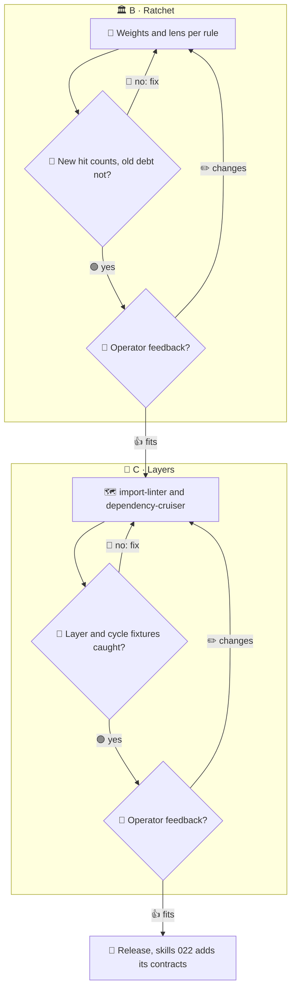

# 005 - Architecture Score

## User Story

As the operator, I want each commit to show a 🏛️ architecture score from the structural rules Quality already runs and, later, from declared layer contracts, so that a change that makes the code harder to change or breaks its layering is visible before it lands.

## Decisions (operator-confirmed 2026-11-18; do not re-litigate)

1. **Stage B: ratchet over existing rules**: 🏛️ = 100 minus 10 per new hit of `clean.complexity`, `clean.function-length`, `clean.parameters`, `clean.clones` and `coding.structural`, minus 25 per new breach of `clean.file-lines` (500) or the folder limit (12 items), against `--base` (`HEAD` for `--staged`), at least 0. Debt that exists at the base never counts.
2. **Principle names**: every counted rule carries a `lens` (SRP, DRY, KISS, fail fast) in `rules/*.yml`, taken over from `principles.py`; the report names it. `principles.py` retires.
3. **Stage C: layer contracts**: `.quality/architecture.yml` declares layers and forbidden imports; Python through `import-linter`, JavaScript through `dependency-cruiser`; `architecture.layer` (forbidden import) and `architecture.cycle` (import cycle) count 25 each.
4. **Gate like security, never forbidding**: 🏛️ below 100 asks the operator (exit 3).
5. **Accepted hits**: as in 004 decision 6.

## Approach

## Acceptance Criteria

### Stage B

- [x] A function the change pushes over the complexity limit lowers 🏛️ by 10; the same function over the limit already at the base lowers nothing.
- [x] A file the change pushes past 500 lines lowers it by 25.
- [x] A new JavaScript clone found by jscpd lowers it by 10.
- [x] Every counted rule in `rules/*.yml` has a `lens`.
- [x] `quality --staged --json` reports `architecture` (number) and per counted hit its rule and lens.
- [ ] `kvb-quality-score` takes `--architecture <n>`.

### Stage C

- [ ] A fixture Python module importing a forbidden layer gives one `architecture.layer` hit; removing the import removes it.
- [ ] A fixture JavaScript import cycle gives one `architecture.cycle` hit.

### Tests

- **Unit**: one fixture per counted rule, each with a negative control at the base.
- **Integration**: `kvb-quality-architecture --staged` on a fixture repository returns the score and the lens per hit.
- **E2E**: n/a: no page.
