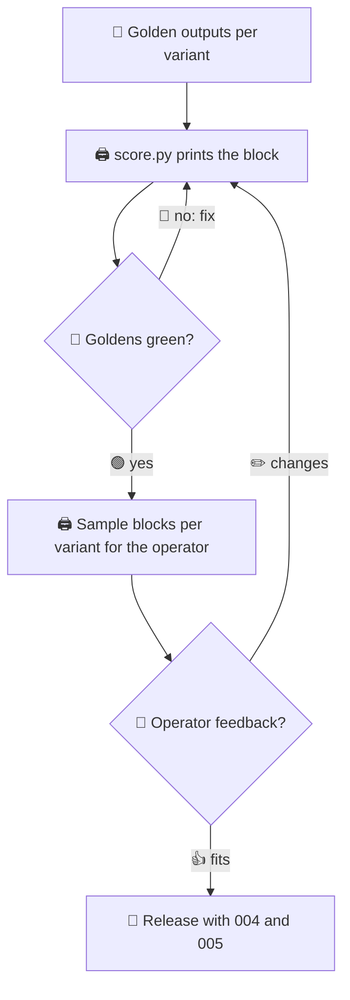

# 006 - Score Block Display

## User Story

As the operator reading scores in chat, in the Agent Orchestrator, in commit messages and in approval prompts, I want one narrow block with every metric on its own line, notes only where a value needs one and the gate apart, so that it reads correctly everywhere, plain text included.

## Decisions (operator-confirmed 2026-11-18; do not re-litigate)

1. **Format**, exactly:

   ```text
   Metrics:
   🎯 Fix: 95 %
   💥 Break: 3 %
   💸 Tokens: –
   ⏱️ Velocity: –
   🛡️ Security: 100 %
   ⚖️ Legal: 100 %
   🏛️ Architecture: 90 % ¹
   🏆 Score: 83
   ---
   ¹ 1 new hit: clean.function-length

   🚦 Gate: ⚠️ ask: architecture 90 % < 100
   ```

   Rejected: a markdown table (raw pipes in commit messages and prompts), two metrics per line, `[n]` markers. Amended 2026-11-26: the example's score read 89; decision 5 gives 83 for these values, so the example shows 83.
2. **Notes only where needed**: a superscript marker (¹, ², …) follows a value that needs an explanation; the notes follow a `---` line; with nothing to explain there is neither `---` nor a note.
3. **Gate apart**: the gate is the last line, after a blank line: `🚦 Gate: ✅ <rule met>`, `⚠️ ask: <causes>` or `⛔ do not commit: <cause>`.
4. **One block everywhere**: chat and `--message-block` show the same text; `--commit-table` keeps its 📁 worktree, 🌿 branch and 📊 diff stat lines above `Metrics:`. The hub that reads it lives in the skills repository (`orchestrator/`, skills 022).
5. **Score**: 🏆 = fix × (100 − break) / 100 × 100 / tokens × 100 / velocity × security / 100 × legal / 100 × architecture / 100.
6. **Goldens replace parity**: the golden outputs of this requirement replace the parity check of 003 once the block changes.
7. **Notes from the caller** (operator 2026-11-26): `score.py` takes a repeatable `--note <metric>=<text>`, one per metric key of `labels.json`; markers follow the block's line order. A fix under 90 or a break over 5 needs the operator's word, not a stop, so it shows as `⚠️ ask:` and keeps exit 1. Rejected: deriving notes from `kvb-quality-review`'s JSON (couples `score.py` to the review contract); both.
8. **Breaking release** (operator 2026-11-26): the block replaces the two lines, `--table` and the markdown `--commit-table`, so the commit is `feat(score)!:` with a `BREAKING CHANGE:` footer and the release is 1.0.0. Rejected: minor 0.5.0.

## Approach



## Acceptance Criteria

### Format

- [x] `score.py … --message-block` prints exactly the block of decision 1 for its fixture values.
- [x] With every value at its target, the output holds no `---` and no marker.
- [x] No line above the `---` is wider than 30 characters.

### Tests

- **Unit**: golden tests per variant (no notes, two notes, ask, do not commit); negative control: a changed separator fails.
- **Integration**: a `--message-block` passed to `git commit -m` in a scratch repository comes back from `git log --format=%B` byte for byte.
- **E2E**: n/a: no page here; the Match card e2e is skills 022.
