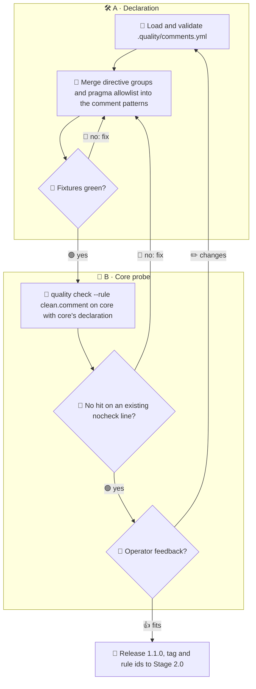

# 007 - Repository Directive Spellings

## User Story

As the operator, I want a repository to declare its own directive spellings and the tool pragmas it permits, so that quality's comment rules can run on a repository such as core without flagging its 22,686 existing waiver markers as narration.

## Decisions (operator-confirmed 2026-11-26; do not re-litigate)

1. **Declared in `.quality/comments.yml`**: a repository file beside `.quality/architecture.yml` and `.quality/legal.yml` with two optional keys. `directives:` lists groups in the schema of `rules/comments.yml` `directives` (`tool`, `spellings`, optional `languages`, `marker`, `tight`, `position`); they join the catalogue's groups for every rule that reads `@directive` or `@positional`. `pragmas_allowed:` lists regexes; a pragma that matches one is no `clean.tool-pragma` hit. Rejected: a key in `.qualityignore.yml` (mixes waivers with comment syntax).
2. **Accepted, never waiving**: a declared directive is a legitimate comment and nothing more. Core's `# nocheck: <slug>` names core's own tests, not catalogue rules; quality waivers stay `nocheck: <rule.id> -- <reason>`. Rejected: a slug-to-rule-id map (a second source for waiver semantics).
3. **Validated like rule data**: an unknown key, a group without `spellings`, a regex that does not compile for Python and for Rust's regex crate, or a `languages` entry quality does not know exits 2 with the file and the key. A missing file changes nothing.
4. **Read from the target**: the file is read from the snapshot under check (`--base` reads the base's), so the declaration a commit adds applies to that commit. Amended 2026-11-26: quality keeps no result cache, so no cache key carries the file.
5. **Release**: ships in 1.1.0 together with 008, so core can widen `make lint-quality` (Stage 2.0, test optimisation wave 4).

## Approach

## Acceptance Criteria

### Declaration

- [x] A fixture repository whose `.quality/comments.yml` declares `nocheck:\s*[a-z0-9-]+(?:,\s*[a-z0-9-]+)*` gets no `clean.comment` hit for an added `# nocheck: self-path-reference`; without the file it gets one.
- [x] `pragmas_allowed: ['noqa:\s*[A-Z]+\d+(?:,\s*[A-Z]+\d+)*']` turns an added `# noqa: E501` into no `clean.tool-pragma` hit, while a bare `# noqa` still is one.
- [x] A declared `# nocheck: <slug>` on a line with a catalogue hit leaves that hit reported.
- [x] A group limited to `languages: [python]` accepts the spelling in a `.py` file and not in a `.sh` file.
- [x] An unknown key, a group without `spellings` and a regex that fails to compile each exit 2 naming `.quality/comments.yml` and the key.
- [x] With `--base`, a declaration added in the change applies to the change's added lines.

### Core probe

- [x] On core with a declaration for its `nocheck:` spelling, `quality check --all --rule clean.comment` reports no hit on a comment that is a core `nocheck:` marker. Amended 2026-11-26: a comment or docstring that only quotes a marker, or a `nocheck:` without a slug, stays narration.

### Tests

- **Unit**: loader and validator (each refusal above), pattern merge per language; negative control: removing the declaration brings the `clean.comment` hit back.
- **Integration**: a fixture git repository through `quality check --staged` with and without the file, and `--base` reading the base's declaration.
- **E2E**: n/a: no page.
