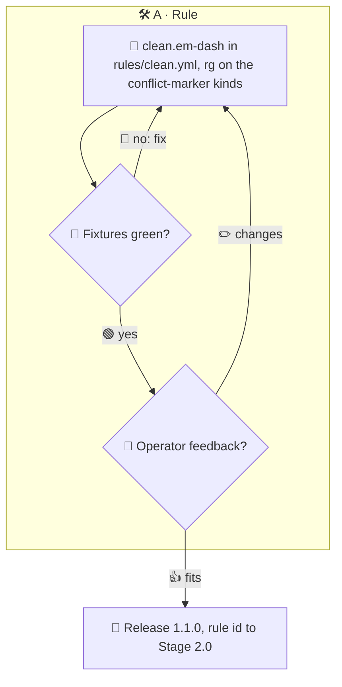

# 008 - No Em Dash

## User Story

As the operator, I want quality to refuse an em dash (U+2014) in every new line of every repository, so that my writing rule holds everywhere without each repository carrying its own check.

## Decisions (operator-confirmed 2026-11-26; do not re-litigate)

1. **Rule `clean.em-dash`**: severity medium, summary "Em dash added; use a colon, a semicolon or a comma". Rejected: ruff RUF001-003 (Python only, and core ignores them on purpose).
2. **Scope**: every kind `coding.conflict-marker` covers (code, data formats, markdown, templates, workflows); translation catalogues (`.po`) stay out, since translators own their typography and quality has no `.po` kind.
3. **New lines only**: like every rule, diff mode reports only added lines; existing em dashes are debt the ratchet never counts.
4. **Waivable**: a `nocheck: clean.em-dash -- <reason>` waives one line, for text that quotes a third party verbatim.
5. **Release**: ships in 1.1.0 with 007.

## Approach

## Acceptance Criteria

### Rule

- [x] An added line holding U+2014 in a `.py`, a `.md` and a `.yml` file each gives one `clean.em-dash` hit; an en dash (U+2013) and a hyphen give none.
- [x] An em dash in a `.po` file gives no hit.
- [x] An em dash already present at the base gives no hit in `--base` mode.
- [x] `nocheck: clean.em-dash -- quotes upstream` on the line waives it.
- [x] `quality check --all` on this repository reports no `clean.em-dash` hit.

### Tests

- **Unit**: rule fixtures per kind with a negative control (U+2013, a hyphen).
- **Integration**: a fixture git repository through `quality check --staged` with an added em dash exits 1, without it exits 0.
- **E2E**: n/a: no page.
