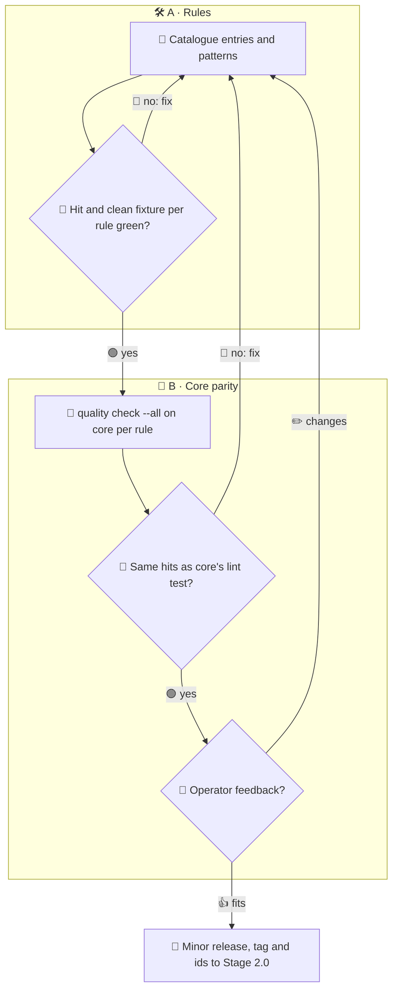

# 009 - Pattern Rules From Core's Generic Lints

## User Story

As the operator, I want the generic pattern checks that core runs as its own pytest lints to become quality rules, so that every repository gets them and core can delete its copies (Stage 2.0 test optimisation, wave 4 b).

## Decisions (operator-confirmed 2026-11-26; do not re-litigate)

1. **Rules**, each soft, waivable by `nocheck`, on added lines only:

   | Rule | Severity | Kinds | Flags |
   | --- | --- | --- | --- |
   | `security.workflow-fork-checkout` | high | workflow | `pull_request_target` together with a checkout of `github.event.pull_request.head` in one file |
   | `security.sudo-preserve-env` | high | shell, make, dockerfile, workflow | `sudo -E`, `sudo --preserve-env` |
   | `clean.private-use-char` | medium | every text kind of `coding.conflict-marker` | a code point in U+E000-U+F8FF or U+F0000-U+10FFFD |
   | `coding.workflow-runner-latest` | medium | workflow | `runs-on:` naming a `-latest` image |
   | `coding.shell-or-true` | medium | shell | a list whose last command is `true` or `:` after `\|\|` |
   | `coding.empty-except` | medium | python | ruff S110 and S112 |
   | `coding.workflow-timeout` | low | workflow | `timeout-minutes:` above 355, the headroom under GitHub's 360 |
   | `coding.dockerfile-syntax-directive` | low | dockerfile | a `# syntax=` line |
   | `coding.distro-codename-tag` | low | dockerfile, yaml | an image tag naming a Debian codename (`buster`, `bullseye`, `bookworm`, `trixie`) |
   | `coding.timeout-foreground` | low | python | an argv list starting with `timeout` without `--foreground` |
   | `clean.line-reference` | low | markdown | a link target ending in `#L<n>` or `:<n>` |
   | `clean.todo-without-link` | low | every kind with comments | a `TODO` comment without an `http(s)://` link |

2. **Extended, not new**: a Dockerfile `ARG name=value` with a non-free value joins `clean.default-value`.
3. **Core-only stays in core**: requirement references (`req 042`), core's path and wrapper bans and everything the lane classified keep-core.
4. **Release**: one minor release after 1.0.0; its tag and rule ids go to Stage 2.0, which deletes core's copies.

## Approach

## Acceptance Criteria

### Rules

- [x] Each rule of decision 1 gives one hit on its fixture line and none on a clean control line.
- [x] A Dockerfile `ARG TAG=latest` gives one `clean.default-value` hit; `ARG TAG` and `ARG TAG=""` give none.
- [x] `quality --all` on this repository reports none of the new rules.

### Core parity

- [x] For each rule, `quality check --all --rule <id>` on core main finds the files core's matching lint test reports, or the difference is listed with its reason in this file.

Differences on core main 6d48a2fb39 (2026-11-26), where every core lint is green:

- **Waivers**: core waives with its own slugs (`# nocheck: shell-or-true`, `timeout-foreground`, `empty-except`, `debian-codename`, `dockerfile-arg-default`); by requirement 007 decision 2 those slugs waive nothing here. Before core deletes a lint, its waivers move to the rule id (`# nocheck: coding.shell-or-true -- <reason>`): 303 lines for `coding.shell-or-true`, 2 for `coding.empty-except`, 1 for `coding.timeout-foreground`, 1 for `clean.default-value`.
- **`coding.shell-or-true`**: also flags `$(cmd || true)`, because the list ends in `true` there too (decision 1); core's test stops at end of line, `;` or `#`. 80 lines in core.
- **`coding.empty-except`**: ruff S110 and S112 flag a `pass` or `continue` handler of a bare `except:` or `except Exception:` (ruff's `check-typed-exception` stays off), so a typed `except ValueError: pass` that core's test flags passes here; core's test exempts `continue`, the SIM105 shape and the focused lookup, attribute and codec handlers, and `# noqa` waives nothing here (requirement 007). 24 handlers in core, 21 of them in tests.
- **`security.workflow-fork-checkout`**: a pattern over the file; core's test reads the job graph and accepts a checkout gated by `fork-trust-gate`. 5 gated lines in 4 core workflows need a waiver naming that gate.
- **`coding.distro-codename-tag`**: `buster`, `bullseye`, `bookworm` and `trixie` in a `FROM` or `image:` reference; core's test also knows the older and newer codenames and reads `*version:` and `*tag:` values. 0 hits on both sides.
- **`security.sudo-preserve-env`**: shell, make, dockerfile and workflow kinds; core's test also scans Ansible YAML and skips `docs/` and tests. 0 hits on both sides.
- **`clean.todo-without-link`**: any `http(s)` link satisfies it; core's test asks for an `open.project.infinito.nexus` link and only warns. 598 comments in core, 583 of them inside the reasons of core's own waivers.
- **`clean.default-value`** (Dockerfile `ARG`): free values (`""`, `false`, `none`, `null`) pass; core's `test_arg_without_default.py` flags every default.
- **`coding.timeout-foreground`**: 1 hit, a fixture string inside core's own lint test.
- **No core lint on main**: `clean.private-use-char` and `clean.line-reference` exist as core lints only on the IAM line (`test_l19_no_private_use_chars.py`, `test_no_line_references.py`). On main, `clean.line-reference` finds 2 lines with `#L<n>` links in `docs/requirements/040-translation-gateway.md`; `clean.private-use-char` finds none. Core's line-reference lint also flags backticked `path:<n>` outside links.

### Tests

- **Unit**: n/a: the rules are catalogue data; the integration fixtures exercise them.
- **Integration**: one fixture repository per rule with a hit line, a clean control and a `nocheck` waiver.
- **E2E**: n/a: no page.
