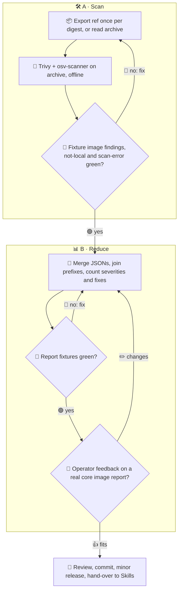

# 010 - Image Vulnerability Scan

## User Story

As a maintainer of a repository that builds or pulls container images, I want `quality` to scan those images for known vulnerabilities and reduce the findings to one row per image, so that the fix skill in skills reads one JSON instead of thousands of CI scan lines.

## Decisions (operator-confirmed 2026-11-27; do not re-litigate)

1. **Own command**: `quality image <ref|archive>... [--json]` scans the named images; `quality image report <json>... [--json]` reduces. Rejected: a catalogue rule inside `quality check` on `FROM` and `image:` lines (hidden pulls and image-size work in every check); both (two entry points).
2. **Local only, never pulls**: a daemon reference is exported once per digest with `docker save` into scratch; an OCI layout directory or a `docker save` tar is read as is. A reference not present locally becomes an unscanned row `not local`. Engines run on the archive only, so neither can pull. Pull limits stay with the caller; the README tells callers to pull through a registry mirror or cache. Rejected: pulling inside quality (registry rate limits, network per run).
3. **Engines**: Trivy and osv-scanner, offline, from the vulnerability bundle `quality db update` already fetches; ids are merged per image and each finding names the engines that reported it. Rejected: Trivy only.
4. **Same findings schema**: one finding per vulnerable package and image under the new rule `security.vulnerable-image` (high); its path is the image reference, its message names package, installed version, fixed-in version and ids, in the schema `quality check --json` writes. A scan error is an unscanned entry, never a silent pass.
5. **Reduction**: one row per image keyed by last path segment and tag, so registry and mirror prefixes join; columns: image, tag, CVE ids per severity (`C`, `H`, `M`, `L`, `?`), ids with a fixed-in version over all ids with the two most frequent packages and their highest fixed-in version, ids without a fix, engines; unscanned images are listed with their reason. Rejected: importing core's CI aggregate or GitHub issues (that stays with skills).
6. **No fix actions**: bump, rebuild and suppress stay in the skills repository's fix skill, which reads this JSON; quality proposes no action.
7. **Release**: one minor release after 009's; tag and command go to Skills.

## Approach

## Acceptance Criteria

### Scan

- [x] `quality image <ref>` on a local image exports it once (one `docker save` per digest when the ref is passed twice) and writes findings under `security.vulnerable-image` with package, installed, fixed-in and ids.
- [x] `quality image <archive.tar>` and `quality image <oci-dir>` give the same findings as the daemon ref of the same image.
- [x] A ref missing from the local daemon gives an unscanned entry `not local`, exit 1, and no pull: the test's fake `docker` records no `pull` call and neither engine runs with a remote image source.
- [x] Both engines run offline on the bundle only; a missing bundle exits 2 naming `quality db update`.
- [ ] `quality db update` also fetches Trivy's Java database, so an image with JAR files scans offline (phase B, operator 2026-11-27): `test_fetch_trivy_loads_the_vulnerability_and_the_java_database`, then a rerun on `infinito-nexus-core/debian:latest`.
- [x] A scan error of either engine on an image gives an unscanned entry with the engine and its first error line.

### Reduce

- [x] `quality image report a.json b.json` joins `registry.example/x/nginx:1.27` and `mirror.example/nginx:1.27` into one row.
- [x] The row shows severity counts, `fixed/total` with the top two packages, the no-fix ids and the engines; `--json` carries the same fields.
- [x] Unscanned images appear in their own list with the reason.

### Docs

- [x] The README documents both commands, the local-only rule and the advice to pull through a mirror or cache.

### Tests

- **Unit**: reference split (registry, path, tag, digest), severity and fix counting, merge of two engines' ids.
- **Integration**: fake `docker`, `trivy` and `osv-scanner` binaries on PATH: export once per digest, not-local without pull, scan error, archive and OCI inputs, report joins.
- **E2E**: n/a: no page; one manual run on a core image is the operator checkpoint of phase B.
