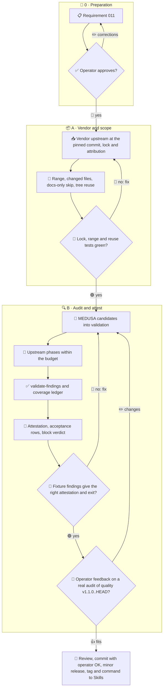

# 011 - Release Security Audit

## User Story

As the maintainer who cuts a release with skills' `kvb-release-cut`, I want a `kvb-quality-audit` skill that audits the code changed since the last release with Cloudflare's security-audit method and hands back one attestation per tree, so that no release ships a confirmed critical or high vulnerability and an unchanged tree is never audited twice.

## Decisions (operator-confirmed 2026-11-27; do not re-litigate)

1. **Own skill in quality**: `skills/kvb-quality-audit/`, the ninth `kvb-quality-*` folder; 003 decision 1 (exactly eight) is amended to nine. Called by skills' `kvb-release-cut` (skills requirement 076). Rejected: a lens inside `kvb-quality-security` (MEDUSA stays the fast per-commit scan; the audit is the slow per-release one).
2. **Pinned upstream, vendored**: `cloudflare/security-audit-skill` (MIT) is vendored under `skills/kvb-quality-audit/upstream/` at commit `c1c8a8c1471069fb0e188eeaff69b8e8db6564a8` with its `LICENSE` and a lock file holding the commit and a sha256 per file; attribution in the skill's README and the repository's notice list. Upstream has no tags, so the pin is a commit. Rejected: fetching at run time (network per release, unpinned code).
3. **Range**: newest `vX.Y.Z` tag reachable from HEAD to HEAD; `--range <a>..<b>` overrides. Scope is the changed files plus the trust-boundary neighbours the reconnaissance phase names; a range that changes only Markdown, plain text or images is skipped with the attestation verdict `skipped: docs-only`. Rejected: whole-repository audits per release (cost).
4. **MEDUSA seeds validation**: the MEDUSA findings of the range (from `kvb-check-security`'s per-file cache) enter the validation phase as candidates. A `rejected` verdict with its source trace becomes the `security.py accept` row of that finding; no manual skeptic round. The audit also hunts holes in its own logic and trust handling.
5. **Release block**: a `confirmed` critical or high finding blocks the release (exit 1); `needs_validation` records carry no severity upstream and block by decision 9.
6. **Output outside the tree**: every run writes to the directory `--out` names (`/tmp/...` or a git-ignored directory of the target), never `~/security-audit-skill`; a tracked path is refused. Target code runs only in the upstream's sandbox rules (no network, empty environment, read-only target); without an enforceable sandbox the step is recorded as `needs_validation`, never run.
7. **Cost first**: reuse the attestation of an unchanged tree (same tree id: no run), the MEDUSA per-file cache and the 064 review memory; upstream profile `quick` unless `--profile` says otherwise; an agent budget (`--budget <n>`, required) caps every agent invocation; models per `kvb-org-perform`; phases that run Docker or a test suite go through `queue.py hold`. Every attestation reports tokens and minutes.
8. **Attestation**: `attestation-<tree id>.json` in `--out`: tree id, range, upstream pin, profile, budget used, counts per verdict (`confirmed`, `needs_validation`, `rejected`) and per severity of the confirmed ones, accepted MEDUSA rows, tokens, minutes, and the verdict `pass`, `blocked` or `skipped: docs-only`. `findings.json` must pass upstream's `validate-findings.cjs` and the ledger `validate-coverage-ledger.cjs` before an attestation is written.
9. **needs_validation fails closed**: every `needs_validation` record blocks the release (attestation `blocked`, exit 1) until a later run confirms or rejects it. Rejected: blocking only candidates seeded by a critical or high MEDUSA finding (the audit's own unverified finds would pass), listing only (an unverified hole would ship).

## Approach

## Acceptance Criteria

### Vendor

- [x] `skills/kvb-quality-audit/upstream/` holds the upstream `skills/security-audit/` files and `LICENSE` at the pinned commit; `lock.json` names the commit and a sha256 per file, and a test fails on any changed byte.
- [x] The skill's README and the repository notice name Cloudflare, the MIT licence and the upstream URL.
- [x] `skills/` holds nine `kvb-quality-*` folders and 003 decision 1 says nine.

### Scope

- [x] Without `--range`, the range is the newest `vX.Y.Z` tag reachable from HEAD to HEAD; with none, the run exits 2 naming `--range`.
- [x] A docs-only range writes the verdict `skipped: docs-only` and starts no agent.
- [x] A second run on the same tree id returns the stored attestation and starts no agent.
- [x] `--out` on a tracked path, or missing, exits 2.

### Audit

- [x] MEDUSA findings of the range appear as validation candidates; a `rejected` one with a source trace produces exactly one `security.py accept` row.
- [x] A `confirmed` critical or high finding makes the attestation `blocked` and the command exit 1; only lower ones give `pass` and exit 0.
- [x] One `needs_validation` record, of any origin, makes the attestation `blocked` and the command exit 1.
- [x] An attestation is written only after `validate-findings.cjs` and `validate-coverage-ledger.cjs` exit 0.
- [x] A coverage ledger whose `reviewed_paths` miss a changed file is refused with exit 2, since the upstream validator accepts an empty ledger: `test_a_ledger_that_skips_a_changed_file_is_refused`.
- [x] Agent invocations never exceed `--budget`; the attestation reports the budget used, tokens and minutes.

### Docs

- [x] The skill's SKILL.md names the command, every option, the attestation schema and the exit codes; README lists the skill.

### Tests

- Unit: lock verification, range resolution, docs-only detection, attestation counts and verdict per fixture `findings.json`, tracked-path refusal.
- Integration: fixture `findings.json` and ledger through the real upstream validators to an attestation; MEDUSA fixture to one acceptance row; same tree reuse without agents.
- E2E: one real audit of quality `v1.1.0..HEAD` at profile `quick` with its attestation, tokens and minutes shown at the operator checkpoint.
